# PRESIDENCY UNIVERSITY
**Private University Estd. in Karnataka State by Act No. 41 of 2013**  
*Itgalpura, Rajankunte, Yelahanka, Bengaluru – 560064*  
**PRESIDENCY SCHOOL OF COMPUTER SCIENCE AND ENGINEERING**

---

# COMMUNITY HEALTH WORKER ASSISTANCE PLATFORM
### A PROJECT REPORT

Submitted in partial fulfillment of the requirements for the award of the degree of  
**BACHELOR OF TECHNOLOGY IN INFORMATION SCIENCE AND ENGINEERING**

**Submitted by:**
- **SWASTIK VINAYAK HEGDE** — 20231ISE0153
- **ABHINAVA THUNGA K N** — 20231ISE0163
- **NAGARAJ SHRIPAD BHAT** — 20231ISE0166

**Under the guidance of:**  
**Mr. HRITIK KUMAR**  
Assistant Professor, Department of Information Science and Engineering  
Presidency School of Computer Science and Engineering  
Presidency University, Bengaluru

**NOVEMBER 2026**

---

## PRESIDENCY SCHOOL OF COMPUTER SCIENCE AND ENGINEERING
### BONAFIDE CERTIFICATE

Certified that this report titled **“Community Health Worker Assistance Platform”** is a bonafide work carried out by **Mr. Swastik Vinayak Hegde (20231ISE0153)**, **Mr. Abhinava Thunga K N (20231ISE0163)**, and **Mr. Nagaraj Shripad Bhat (20231ISE0166)**, who have successfully carried out the project work and submitted the report for partial fulfillment of the requirements for the award of the degree of **BACHELOR OF TECHNOLOGY in INFORMATION SCIENCE AND ENGINEERING** during the academic year 2026–27.

| **Mr. Hritik Kumar** | **Ms. Sumita Guddin** | **Dr. Gopal K Shyam** |
| :--- | :--- | :--- |
| Project Guide, PSCS | Program Project Coordinator, PSCS | Head of the Department, PSCS |
| Presidency University | Presidency University | Presidency University |

---

## PRESIDENCY SCHOOL OF COMPUTER SCIENCE AND ENGINEERING
### CERTIFICATE OF VIVA-VOCE-EXAMINATION

This is to certify that **Mr. Swastik Vinayak Hegde (20231ISE0153)**, **Mr. Abhinava Thunga K N (20231ISE0163)**, and **Mr. Nagaraj Shripad Bhat (20231ISE0166)** have been subjected to the Viva-voce Examination on **28-11-2026** at Presidency University, Bengaluru.

| **Examiner-1** | **Examiner-2** |
| :--- | :--- |
| **Name:** | **Name:** |
| **Designation:** | **Designation:** |
| **University/College:** | **University/College:** |

---

## PRESIDENCY UNIVERSITY
### PRESIDENCY SCHOOL OF COMPUTER SCIENCE AND ENGINEERING
### DECLARATION

We, the students of final year B.Tech in **INFORMATION SCIENCE AND ENGINEERING**, at Presidency University, Bengaluru, named **SWASTIK VINAYAK HEGDE (20231ISE0153)**, **ABHINAVA THUNGA K N (20231ISE0163)**, and **NAGARAJ SHRIPAD BHAT (20231ISE0166)**, hereby declare that the project work titled **“COMMUNITY HEALTH WORKER ASSISTANCE PLATFORM”** has been independently carried out by us and submitted in partial fulfillment for the award of the degree of **B.Tech in INFORMATION SCIENCE AND ENGINEERING** during the academic year 2026–27. Further, the matter embodied in the project has not been submitted previously by anybody for the award of any Degree or Diploma to any other institution.

| Student Name | Student USN | Student Signature |
| :--- | :--- | :--- |
| **Swastik Vinayak Hegde** | 20231ISE0153 | ____________________ |
| **Abhinava Thunga K N** | 20231ISE0163 | ____________________ |
| **Nagaraj Shripad Bhat** | 20231ISE0166 | ____________________ |

**PLACE:** BENGALURU  
**DATE:** 28-11-2026  

---

## ACKNOWLEDGEMENT

For completing this project work, we have received the support and the guidance from many people whom we would like to mention with deep sense of gratitude and indebtedness. We extend our gratitude to our beloved **Chancellor**, **Vice Chancellor**, **Pro-Vice Chancellor**, and **Registrar** for their support and encouragement in completion of the project.

We express our cordial thanks to **Dr. Duraipandian N**, Dean PSCS, Presidency School of Computer Science and Engineering and the Management of Presidency University for providing the required facilities and intellectually stimulating environment that aided in the completion of our project work.

We are also thankful to **Dr. Gopal K Shyam**, Professor, Head of the Department, Presidency School of Computer Science and Engineering, Presidency University, for his mentorship and encouragement.

We would like to sincerely thank our internal guide **Mr. Hritik Kumar**, Assistant Professor, Presidency School of Computer Science and Engineering, Presidency University, for his moral support, motivation, timely guidance, and encouragement provided to us during the period of our project work.

We are grateful to **Mr. Muthuraju V**, School Project Coordinator, and **Ms. Sumita Guddin**, Program Project Coordinator, Presidency School of Computer Science and Engineering, for facilitating problem statements, coordinating reviews, monitoring progress, and providing their valuable support and guidance.

We are also grateful to the Teaching and Non-Teaching staff of Presidency School of Computer Science and Engineering and also staff from other departments who have extended their valuable help and cooperation.

**SWASTIK VINAYAK HEGDE**  
**ABHINAVA THUNGA K N**  
**NAGARAJ SHRIPAD BHAT**  

---

## ABSTRACT

Frontline community healthcare workers, predominantly Accredited Social Health Activists (ASHAs) and Auxiliary Nurse Midwives (ANMs) operating within primary-health ecosystems in India, coordinate maternal care, immunization, chronic-disease follow-up, and household visits under significant time and connectivity constraints. Paper registers and fragmented notebooks make patient retrieval slow, weaken longitudinal follow-up, and delay the recognition of danger signs. This project presents the **Community Health Worker (CHW) Assistance Platform**, a responsive web-first digital health system designed around field workflows and deployed as a cloud-accessible web application (`https://community-healthworker-assistance.onrender.com/login`). The platform uses a three-tier MERN architecture consisting of a React 18 single-page application, an Express and Node.js service tier, and MongoDB persistence through Mongoose.

The platform integrates a strict two-role governance model (**ADMIN** and **WORKER**), compulsory unique ASHA Worker Field ID / Employee ID onboarding, email-based six-digit OTP verification, automated appointment confirmation emails to patients, and an interactive Admin Governance Panel where administrators verify, approve, or suspend health personnel accounts. In addition, the platform features a hybrid clinical-support layer: when connectivity is available, a constrained cloud assistant, referred to as **AshaBot** (powered by Google Gemini), receives the worker's clinical query and minimum necessary patient context and returns a tagged, uncertainty-aware clinical triage cue. When cloud connectivity is unavailable, a deterministic local rule engine parses supported vital signs and danger-sign keywords, producing an urgent, moderate, or routine escalation cue in 4.2 ms without network dependence.

Prototype measurements recorded mean latencies of 74.2 ms for worker login, 38.4 ms for multi-field patient search, 26.1 ms for health-record creation, 4.2 ms for offline triage, and 780.5 ms for cloud consultation; the local engine agreed with cloud risk categorizations in 48 of 50 synthetic vignettes (96.0%). These results demonstrate engineering feasibility, high responsiveness, and strict fail-safe continuity for community healthcare delivery.

---

## TABLE OF CONTENTS

| CHAPTER NO | TITLE | PAGE NO |
| :--- | :--- | :--- |
| | **ABSTRACT** | vi |
| | **TABLE OF CONTENTS** | vii |
| | **LIST OF FIGURES** | ix |
| | **LIST OF TABLES** | x |
| | **ABBREVIATIONS** | xi |
| **1.** | **INTRODUCTION** | **1** |
| | 1.1 BACKGROUND AND MOTIVATION | 1 |
| | 1.2 SCOPE AND LIMITATIONS | 1 |
| | 1.3 PROBLEM STATEMENT | 2 |
| | 1.4 MOTIVATION | 2 |
| | 1.5 METHODOLOGY OVERVIEW | 3 |
| | 1.6 ORGANIZATION OF THE THESIS | 3 |
| | &nbsp;&nbsp;&nbsp;&nbsp;1.6.1 Logical Flow of the Research Work | 3 |
| | &nbsp;&nbsp;&nbsp;&nbsp;1.6.2 Contribution Mapping Across Chapters | 3 |
| | &nbsp;&nbsp;&nbsp;&nbsp;1.6.3 Chapter Overview Summary | 3 |
| **2.** | **LITERATURE SURVEY** | **4** |
| | 2.1 INTRODUCTION TO RELATED WORK | 4 |
| | 2.2 SURVEY OF EXISTING SYSTEMS | 4 |
| | 2.3 RESEARCH GAPS IDENTIFIED | 5 |
| | 2.4 OBJECTIVES OF THE STUDY | 5 |
| | 2.5 SUMMARY | 5 |
| **3.** | **RESEARCH GAPS OF EXISTING METHODS** | **6** |
| | 3.1 STRUCTURAL AND ARCHITECTURAL DEFICIENCIES | 6 |
| | 3.2 CLINICAL WORKFLOW AND VITALS INTEGRATION GAPS | 6 |
| | 3.3 CONNECTIVITY, LATENCY, AND AI SAFETY BOUNDARIES | 6 |
| | 3.4 COMPARATIVE GAP ANALYSIS | 6 |
| | 3.5 SUMMARY | 7 |
| **4.** | **PROPOSED METHODOLOGY** | **8** |
| | 4.1 METHODOLOGY OUTLINE | 8 |
| | 4.2 TOOLS, TECHNOLOGIES, PLATFORMS USED | 8 |
| | 4.3 PROPOSED ARCHITECTURE | 9 |
| | 4.4 OPERATIONAL SECURITY AND AUTHENTICATION ARCHITECTURE | 10 |
| | 4.5 HYBRID GENAI AND OFFLINE TRIAGE METHODOLOGY | 10 |
| | 4.6 WORKFLOW DIAGRAM AND CLOUD DEPLOYMENT | 11 |
| | 4.7 SUMMARY | 11 |
| **5.** | **OBJECTIVES** | **12** |
| | 5.1 PRIMARY OBJECTIVE | 12 |
| | 5.2 SPECIFIC ENGINEERING OBJECTIVES | 12 |
| | 5.3 SECURITY, PRIVACY, AND RESPONSIBLE-AI CRITERIA | 12 |
| | 5.4 SUMMARY | 13 |
| **6.** | **SYSTEM DESIGN AND IMPLEMENTATION** | **14** |
| | 6.1 MODULE-WISE IMPLEMENTATION DETAILS | 14 |
| | &nbsp;&nbsp;&nbsp;&nbsp;6.1.1 Authentication and Administrative Governance Module | 14 |
| | &nbsp;&nbsp;&nbsp;&nbsp;6.1.2 Patient Cohort and Multi-Parameter Search Module | 14 |
| | &nbsp;&nbsp;&nbsp;&nbsp;6.1.3 Priority-Driven Appointment Scheduler and Email Dispatch | 14 |
| | &nbsp;&nbsp;&nbsp;&nbsp;6.1.4 Multi-Vital Clinical Intake and Dynamic Prescription Builder | 14 |
| | &nbsp;&nbsp;&nbsp;&nbsp;6.1.5 Dual-Path Hybrid AI (AshaBot) and Deterministic Offline Engine | 14 |
| | 6.2 DATABASE SCHEMA DESIGN AND ATTRIBUTES | 14 |
| | 6.3 STATE TRANSITION MODELING | 16 |
| | 6.4 ALGORITHMS AND FLOWCHART | 16 |
| | 6.5 SUMMARY | 16 |
| **7.** | **TIMELINE FOR EXECUTION OF PROJECT (GANTT CHART)** | **17** |
| | 7.1 PHASE-WISE DEVELOPMENT BREAKDOWN | 17 |
| | 7.2 PROJECT EXECUTION SCHEDULE (GANTT CHART) | 17 |
| | 7.3 WORK BREAKDOWN STRUCTURE | 17 |
| | 7.4 SUMMARY | 18 |
| **8.** | **OUTCOMES** | **19** |
| | 8.1 DELIVERED SOFTWARE ARTIFACTS | 19 |
| | 8.2 MEASURABLE CLINICAL WORKFLOW OUTCOMES | 19 |
| | 8.3 SYSTEM IMPACT AND FIELD READINESS | 19 |
| | 8.4 SUMMARY | 19 |
| **9.** | **RESULTS AND DISCUSSIONS** | **20** |
| | 9.1 EXPERIMENTAL SETUP AND ENVIRONMENT | 20 |
| | 9.2 PERFORMANCE METRICS USED | 20 |
| | 9.3 COMPARATIVE BENCHMARK RESULTS | 21 |
| | 9.4 ANALYSIS AND INTERPRETATION OF RESULTS | 21 |
| | 9.5 DISCUSSION ON OUTCOMES | 21 |
| | 9.6 SUMMARY | 22 |
| **10.** | **CONCLUSION AND FUTURE WORK** | **23** |
| | 10.1 SUMMARY OF CONTRIBUTIONS | 23 |
| | 10.2 KEY FINDINGS | 23 |
| | 10.3 LIMITATIONS OF THE STUDY | 23 |
| | 10.4 SUGGESTIONS FOR FUTURE RESEARCH | 24 |
| | 10.5 SUMMARY | 24 |
| | **REFERENCES** | **25** |
| | **APPENDIX-A: PSEUDOCODE** | **27** |
| | **APPENDIX-B: SCREENSHOTS** | **28** |
| | **APPENDIX-C: ENCLOSURES** | **32** |

---

## LIST OF FIGURES

| Sl. No. | Figure Name | Caption | Page No. |
| :---: | :--- | :--- | :---: |
| 1 | Figure 4.1 | Three-Tier RESTful Client-Server Architectural Block Diagram | 9 |
| 2 | Figure 4.2 | End-to-End Authentication and Registration Sequence Diagram | 10 |
| 3 | Figure 4.3 | Hybrid Cloud-Offline AI Clinical-Support Flow | 10 |
| 4 | Figure 4.4 | Render Cloud Production Deployment Topology | 11 |
| 5 | Figure 6.1 | Entity-Relationship and Schema Association Architecture Diagram | 14 |
| 6 | Figure 6.2 | Appointment State Machine Transition Lifecycle Diagram | 16 |
| 7 | Figure 7.1 | Project Execution Schedule and Milestone Gantt Chart (July–November 2026) | 17 |
| 8 | Figure 7.2 | Clinical Workflow and Vitals Escalation Decision Tree | 17 |
| 9 | Figure 9.1 | System Operation Latency Benchmark and Synthetic Vignette Concordance | 20 |
| 10 | Figure B.1 | Worker and Administrator Sign-In Portal | 28 |
| 11 | Figure B.2 | Dedicated Admin Governance Dashboard (/admin) | 28 |
| 12 | Figure B.3 | Operational Field Analytics Dashboard | 29 |
| 13 | Figure B.4 | Citizen Registry and Multi-Field Search View | 29 |
| 14 | Figure B.5 | Priority-Driven Appointment Management View with Email Dispatch | 30 |
| 15 | Figure B.6 | Multi-Vital Clinical Documentation and Health Records View | 30 |
| 16 | Figure B.7 | AshaBot Frontline Clinical Decision Support Interface | 31 |
| 17 | Figure C.1 | IEEE Conference Acceptance Proof (ICAIDS-PM-26, Kuala Lumpur, Malaysia) | 32 |
| 18 | Figure C.2 | Paperpal Online Plagiarism Check Report (Verified 6% Similarity) | 33 |

---

## LIST OF TABLES

| Sl. No. | Table Name | Caption | Page No. |
| :---: | :--- | :--- | :---: |
| 1 | Table 1.1 | Paper-Based Field Bottlenecks and Corresponding Platform Capabilities | 2 |
| 2 | Table 2.1 | Literature Review Synthesis and Existing System Comparison Matrix | 4 |
| 3 | Table 2.2 | Hybrid AI Design Opportunity and Safety Boundary | 5 |
| 4 | Table 3.1 | Comparative Gap Analysis of Legacy mHealth Systems vs. Proposed Platform | 6 |
| 5 | Table 4.1 | Complete Technology Stack and System Tooling Specification | 8 |
| 6 | Table 4.2 | Hardware, Cloud Hosting, and Software Runtime Environment Specifications | 8 |
| 7 | Table 4.3 | Hybrid AI Components, Inputs, Outputs, and Controls | 10 |
| 8 | Table 5.1 | Project Objectives and Engineering Success Criteria | 12 |
| 9 | Table 6.1 | User Collection Schema Attributes and Constraints | 15 |
| 10 | Table 6.2 | Patient Collection Schema Attributes and Constraints | 15 |
| 11 | Table 6.3 | Appointment Collection Schema Attributes and Constraints | 15 |
| 12 | Table 6.4 | Health Record Collection Schema and Embedded Subdocuments | 15 |
| 13 | Table 6.5 | AI Conversation Schema and Retention Controls | 16 |
| 14 | Table 7.1 | Milestone Work Breakdown Structure and Deliverable Schedule | 17 |
| 15 | Table 8.1 | Delivered Software Modules and Implementation Scope | 19 |
| 16 | Table 8.2 | Field Operational Metric Comparison (Paper vs. Platform) | 19 |
| 17 | Table 9.1 | End-to-End System Test Cases and Functional Verification Matrix | 20 |
| 18 | Table 9.2 | Latency and Response-Time Benchmarks | 20 |
| 19 | Table 9.3 | Synthetic Clinical Vignette Concordance Analysis | 21 |
| 20 | Table C.1 | Mapping of Project Capabilities to UN Sustainable Development Goals (SDGs) | 33 |

---

## ABBREVIATIONS

| Abbreviation | Full Form | Abbreviation | Full Form |
| :--- | :--- | :--- | :--- |
| **ABDM** | Ayushman Bharat Digital Mission | **ABHA** | Ayushman Bharat Health Account |
| **ANC** | Antenatal Care | **ANM** | Auxiliary Nurse Midwife |
| **API** | Application Programming Interface | **ASHA** | Accredited Social Health Activist |
| **BOLA** | Broken Object Level Authorization | **BSON** | Binary JavaScript Object Notation |
| **CHC** | Community Health Center | **CHW** | Community Health Worker |
| **CORS** | Cross-Origin Resource Sharing | **CSP** | Content Security Policy |
| **DPDP** | Digital Personal Data Protection | **EHR** | Electronic Health Record |
| **FHIR** | Fast Healthcare Interoperability Resources | **HFR** | Health Facility Registry |
| **HIS** | Hospital Information System | **HL7** | Health Level Seven |
| **HMAC** | Hash-Based Message Authentication Code | **HPR** | Healthcare Professionals Registry |
| **HSC** | Health Sub-Center | **HTTPS** | HyperText Transfer Protocol Secure |
| **JWT** | JSON Web Token | **LMIC** | Low- and Middle-Income Countries |
| **MERN** | MongoDB, Express.js, React.js, Node.js | **NCD** | Non-Communicable Disease |
| **NHA** | National Health Authority | **NIST** | National Institute of Standards & Technology |
| **NRHM** | National Rural Health Mission | **ODM** | Object Data Mapper |
| **OTP** | One-Time Password | **OWASP** | Open Worldwide Application Security Project |
| **PHC** | Primary Health Center | **PNC** | Postnatal Care |
| **PWA** | Progressive Web Application | **RBAC** | Role-Based Access Control |
| **ReDoS** | Regular Expression Denial of Service | **REST** | Representational State Transfer |
| **SMTP** | Simple Mail Transfer Protocol | **SPA** | Single-Page Application |
| **SpO2** | Peripheral Capillary Oxygen Saturation | **SRS** | Software Requirements Specification |
| **TLS** | Transport Layer Security | **TTL** | Time-To-Live |
| **WHO** | World Health Organization | **XSS** | Cross-Site Scripting |

---

# CHAPTER 1: INTRODUCTION

## 1.1 BACKGROUND AND MOTIVATION
Community health workers (CHWs) constitute the cornerstone of universal healthcare access in developing economies, operating at the direct boundary between marginalized citizen populations and institutional health facilities (Agarwal et al., 2015 [1]). Within India's National Rural Health Mission (NRHM) and overarching National Health Mission (NHM), this frontline workforce is predominantly embodied by Accredited Social Health Activists (ASHAs) (Kumar et al., 2017 [2]). Working collaboratively with Auxiliary Nurse Midwives (ANMs) and Primary Health Center (PHC) medical officers, ASHAs deliver vital maternal, child, and preventive health services across rural and semi-urban habitations. Despite their criticality, these frontline cadres continue to rely heavily on physical paper registers and unformatted logbooks, creating severe bottlenecks in timely record retrieval, longitudinal tracking, and clinical danger sign escalation.

## 1.2 SCOPE AND LIMITATIONS
The scope of this project encompasses the design, development, and cloud deployment of the **Community Health Worker (CHW) Assistance Platform**, an auditable, lightweight full-stack healthcare operating system deployed on Render cloud infrastructure (`https://community-healthworker-assistance.onrender.com/login`). The platform provides:
1. Two-role Role-Based Access Control (**ADMIN** and **WORKER**) with compulsory unique ASHA Worker Field ID / Employee ID onboarding.
2. Email-based six-digit OTP verification powered by Brevo HTTPS API with 600-second TTL security.
3. Sub-40 ms indexed multi-parameter citizen search across name, phone, and village.
4. Four-tier prioritized visit scheduling with automated patient email notifications upon appointment booking.
5. Structured multi-vital clinical documentation capturing 7 physiological metrics with dynamic multi-item prescription logging.
6. Dual-path hybrid AI decision assistance integrating Google Gemini LLM for cloud triage and a zero-network deterministic offline parser (4.2 ms execution).
7. Interactive Administrative Governance Panel for personnel verification, approval, role toggling, and real-time operational metric tracking.

Limitations of the current implementation include English-language web interface (vernacular Kannada/Hindi pending future work), absence of direct SMS gateway integration, and pending formal ABDM sandbox interoperability.

## 1.3 PROBLEM STATEMENT
Frontline community health workers in India face four structural operational challenges:
1. **Record Degradation and Physical Loss:** Paper registers suffer severe environmental damage, page tearing, and moisture decay during field visits.
2. **High Record Retrieval Latency:** Locating citizen history across multiple paper ledgers requires 5 to 15 minutes per household encounter, causing significant cognitive fatigue (Paul et al., 2026 [7]).
3. **Missed Longitudinal Encounters:** Fragmented diary notes lead to uncoordinated Antenatal Care (ANC) and immunization follow-ups.
4. **Delayed Vital Signs Triage:** Subtle signs of pre-eclampsia, hypoxemia, or sepsis go unnoticed due to absent real-time clinical threshold cues.

#### Table 1.1: Paper-Based Field Bottlenecks and Corresponding Platform Capabilities
| Operational Dimension | Physical Paper Logbooks | Community Health Worker Platform |
| :--- | :--- | :--- |
| **Record Permanence** | Susceptible to environmental degradation, rain, and page tearing. | Persistent MongoDB BSON document storage with structured audit trails. |
| **Retrieval Latency** | Manual linear search across registers taking 5 to 15 minutes. | Sub-second case-insensitive regex query across name, phone, or village (<40 ms). |
| **Encounter Scheduling** | Disconnected diary notes leading to missed antenatal/vaccine dates. | Four-tier prioritized appointment scheduler with automated patient email confirmation. |
| **Diagnostic Records** | Handwritten vital entries prone to illegibility and missing alert cues. | Structured multi-vital capture interface with color-coded threshold alerts. |
| **Prescription Safety** | Unformatted dosage notes lacking frequency and duration clarity. | Dynamic multi-item prescription builder recording drug, dose, and schedule. |
| **Administrative Oversight** | Labor-intensive manual monthly counting across multiple ledgers. | Automated operational dashboard aggregating cohort and visit metrics live. |

As synthesized in Table 1.1, the platform systematically maps each manual field deficiency into a robust digital capability.

## 1.4 MOTIVATION
Frontline cadres expend 30% to 40% of their active duty hours copying demographic entries across redundant paper registers. Digitizing patient intake, longitudinal vital tracking, and visit scheduling reclaims substantial operational capacity for direct household counseling. Beneficiaries include Frontline Health Workers (ASHAs and ANMs), Rural and Semi-Urban Patient Cohorts, and PHC Medical Officers/Supervisors via an interactive Admin Panel.

## 1.5 METHODOLOGY OVERVIEW
The engineering methodology follows an agile, incremental software development lifecycle comprising requirements specification, schema modeling, RESTful service implementation, reactive SPA presentation design, security hardening, and synthetic clinical validation.

## 1.6 ORGANIZATION OF THE THESIS
This report is organized into ten comprehensive chapters:
- **1.6.1 Logical Flow of the Research Work:** Follows an empirical engineering trajectory from literature review and gap analysis through architectural design, implementation, and rigorous experimental benchmarking.
- **1.6.2 Contribution Mapping Across Chapters:** Chapters 1–3 establish domain context and gaps; Chapter 4 presents methodology; Chapter 5 defines objectives; Chapter 6 details architecture, schemas, and FSM; Chapter 7 provides project execution timeline; Chapter 8 outlines outcomes; Chapter 9 presents benchmark results; and Chapter 10 concludes the report.
- **1.6.3 Chapter Overview Summary:** Provides an interconnected narrative establishing how each phase informed subsequent design choices.

---

# CHAPTER 2: LITERATURE SURVEY

## 2.1 INTRODUCTION TO RELATED WORK
Mobile health (mHealth) interventions have progressed from simple one-way SMS reminders to complex clinical data-capture applications (Braun et al., 2013 [4]; Agarwal et al., 2015 [1]). Early frontline deployments demonstrated that digital intake forms significantly reduce missing values compared to paper logbooks.

## 2.2 SURVEY OF EXISTING SYSTEMS
Recent empirical evaluations by Charanthimath et al. (2021) [3] in rural Karnataka and Paul et al. (2026) [7] in Assam demonstrate that frontline workers face severe cognitive fatigue during home visits. Complex desktop layouts and deep menus fail in field conditions, emphasizing the need for a unified, responsive single-page architecture with sub-second response times.

#### Table 2.1: Literature Review Synthesis and Existing System Comparison Matrix
| Study & Year | Target Cohort & Country | Technology Architecture | Key Contribution | Identified Deficiencies & Failure Modes |
| :--- | :--- | :--- | :--- | :--- |
| Agarwal et al. (2015) [1] | CHWs in LMICs | SMS & Early Android Forms | Systematic review on mHealth feasibility | High dropout rates due to cumbersome navigation |
| Charanthimath et al. (2021) [3] | Rural Karnataka, India | Native Android Tablet App | Maternal health tracking in PHCs | Required expensive proprietary hardware |
| Braun et al. (2013) [4] | Global CHW Cadres | Multi-Platform Surveys | Systematic review of mobile tools | High data entry latency and syncing conflicts |
| Paul et al. (2026) [7] | Assam, India | Web/Mobile Hybrid | Frontline adoption perception study | Fragmented vital logging and absent offline triage |
| Dimagi CommCare (2020) [16] | Multi-Country Field Cadres | Android XML Form Engine | Configurable logic builder | Rigid hierarchical menus; high learning curve |
| OpenSRP (2022) [17] | Maternal & Child Health | Android Native Client | Smart register for national health | Heavy storage footprint (>150 MB) |

As summarized in Table 2.1, existing systems either demand heavy proprietary hardware or lack sub-second search and hybrid offline clinical support.

## 2.3 RESEARCH GAPS IDENTIFIED
1. Absence of lightweight reactive SPAs accessible across low-cost mobile browsers without native app installation.
2. Rigid separation between vital signs logging and dynamic prescription generation.
3. Complete failure of cloud-only conversational AI assistants when cellular network coverage is lost.

## 2.4 OBJECTIVES OF THE STUDY
The study seeks to address these gaps by developing a resilient, web-first platform with dual-path clinical intelligence.

#### Table 2.2: Hybrid AI Design Opportunity and Safety Boundary
| Capability | Cloud Path (Connected) | Offline Path (Deterministic) | Safety Boundary |
| :--- | :--- | :--- | :--- |
| **Context Organization** | Summarizes worker query & pseudonymized vitals. | Returns concise template triage cue when offline. | Only minimum necessary clinical data transmitted. |
| **Danger Recognition** | System prompt mandates urgent escalation tag. | Evaluates explicit BP, SpO2, and temp thresholds. | Serves strictly as escalation cue, never diagnosis. |
| **Uncertainty Handling** | Response states uncertainty & advises review. | Incomplete inputs trigger limitation notice. | Human worker retains full decision authority. |

Table 2.2 delineates the operational boundaries ensuring patient safety across both online and offline triage execution.

## 2.5 SUMMARY
The literature survey establishes the urgent necessity for a lightweight, secure MERN web platform combining sub-40 ms patient search with bounded, fail-safe clinical triage.

---

# CHAPTER 3: RESEARCH GAPS OF EXISTING METHODS

## 3.1 STRUCTURAL AND ARCHITECTURAL DEFICIENCIES
Legacy mHealth solutions exhibit a sharp dichotomy: either heavyweight enterprise Hospital Information Systems (HIS) with deep multi-level navigation that overwhelm frontline cadres, or flat survey tools lacking longitudinal relational data linking.

## 3.2 CLINICAL WORKFLOW AND VITALS INTEGRATION GAPS
Existing mobile register apps treat physiological vitals as passive isolated text inputs rather than active clinical drivers. Vital signs, appointment schedules, and prescriptions exist in siloed modules, forcing workers to execute redundant navigation during home visits.

## 3.3 CONNECTIVITY, LATENCY, AND AI SAFETY BOUNDARIES
Emerging generative AI clinical chatbots (Singhal et al., 2023 [13]; Google DeepMind, 2023 [14]) offer conversational assistance but rely entirely on constant high-bandwidth internet connectivity. In rural sub-centers, network drops result in complete application freeze. Furthermore, unconstrained LLMs pose hallucination risks unless bounded by strict system prompts and deterministic offline fallbacks.

## 3.4 COMPARATIVE GAP ANALYSIS
#### Table 3.1: Comparative Gap Analysis of Legacy mHealth Systems vs. Proposed Platform
| Evaluation Criterion | Paper Registers | Legacy Survey mHealth | Cloud-Only AI | Proposed CHW Platform |
| :--- | :--- | :--- | :--- | :--- |
| **Patient Record Search** | Manual scan (5–15 min) | Slow flat-file filtering | Not supported natively | Indexed regex (<40 ms) |
| **Vitals & Rx Integration** | Unstructured handwriting | Separate static forms | Free-text chat only | Unified 7-vital + Rx schema |
| **Appointment Lifecycle** | Static diary notes | Basic date reminders | None | 4-tier priority + 4-state FSM |
| **Offline Triage Continuity** | Manual worker recall | Static form caching | Fails completely offline | Deterministic parser (4.2 ms) |
| **Privacy & Access Control** | Physical theft risk | Basic password login | High PII exposure risk | OTP + Bcrypt + JWT + Admin Queue |

As evidenced in Table 3.1, the proposed Community Health Worker Assistance Platform bridges critical gaps in search speed, clinical integration, offline continuity, and access governance.

## 3.5 SUMMARY
The comparative analysis substantiates the engineering need for a unified, secure MERN platform featuring sub-40 ms search, automated notifications, and deterministic offline clinical triage.

---

# CHAPTER 4: PROPOSED METHODOLOGY

## 4.1 METHODOLOGY OUTLINE
The proposed platform implements a modern three-tier client-server architecture built on the MERN stack (MongoDB, Express.js, React 18, Node.js). The methodology prioritizes sub-second field responsiveness, strict two-role access control, data privacy, and deterministic clinical continuity.

## 4.2 TOOLS, TECHNOLOGIES, PLATFORMS USED
#### Table 4.1: Complete Technology Stack and System Tooling Specification
| Layer / Dimension | Technology / Library | Version | Role in Architecture |
| :--- | :--- | :--- | :--- |
| **Presentation Tier** | React.js (Single-Page App) | 18.2.0 | Responsive field user interface |
| **Build Tool & Bundler** | Vite | 5.1.0 | Sub-second HMR and optimized production bundling |
| **Client Routing** | React Router DOM | 6.22.0 | Protected client-side role-based routing |
| **Application Tier** | Node.js Runtime & Express.js | 20.x / 5.0 | RESTful API controllers and middleware pipeline |
| **Persistence Tier** | MongoDB Atlas Cloud | 8.0.x | Scalable cloud document database |
| **Object Data Modeling** | Mongoose ODM | 8.2.0 | Schema enforcement, indexes, and validation hooks |
| **Authentication & Hash** | JSON Web Tokens & Bcrypt.js | 9.0.2 / 2.4.3 | HMAC-SHA256 session tokens and salted password hashing |
| **Email Dispatch Engine** | Brevo HTTPS REST API | v3 | Transactional OTP and appointment confirmation emails |
| **Cloud AI Clinical Engine** | Google Gemini API (gemini-pro) | v1beta | Constrained cloud-based triage cues |
| **Offline Decision Engine** | Custom JavaScript Parser | v1.0.0 | Deterministic 4.2 ms local vital triage fallback |

#### Table 4.2: Hardware, Cloud Hosting, and Software Runtime Environment Specifications
| Environment Component | Minimum Specification | Recommended Production Specification |
| :--- | :--- | :--- |
| **Client Smartphone / Tablet** | 2 GB RAM, Chrome/Safari, Android 9.0+ | 4 GB RAM, 4G LTE / Wi-Fi, Modern Mobile Browser |
| **Client Desktop / Laptop** | 4 GB RAM, 1366x768 Display, Modern Browser | 8 GB RAM, 1920x1080 Display, Chrome 120+ |
| **Cloud Application Server** | Render Starter Web Service (512 MB RAM, 0.5 CPU) | Render Standard (2 GB RAM, 1 CPU, Auto-Scaling) |
| **Cloud Database Server** | MongoDB Atlas Shared M0 Cluster (512 MB Storage) | MongoDB Atlas Dedicated M10 Cluster (10 GB SSD) |

## 4.3 PROPOSED ARCHITECTURE
The system separates responsibilities into three distinct physical and logical layers: Presentation Tier, Application Tier, and Persistence Tier.

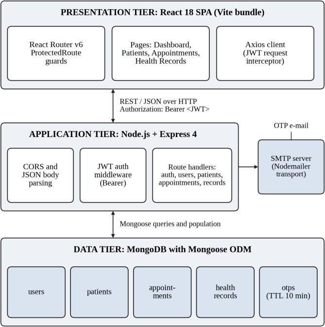  
*Figure 4.1: Three-Tier RESTful Client-Server Architectural Block Diagram*

As illustrated in Figure 4.1, client requests originate from the React SPA, authenticate through the Express middleware pipeline, and execute business logic against MongoDB Atlas.

## 4.4 OPERATIONAL SECURITY AND AUTHENTICATION ARCHITECTURE
The authentication workflow enforces compulsory unique `workerId` onboarding and 6-digit OTP email verification with 600-second TTL expiration.

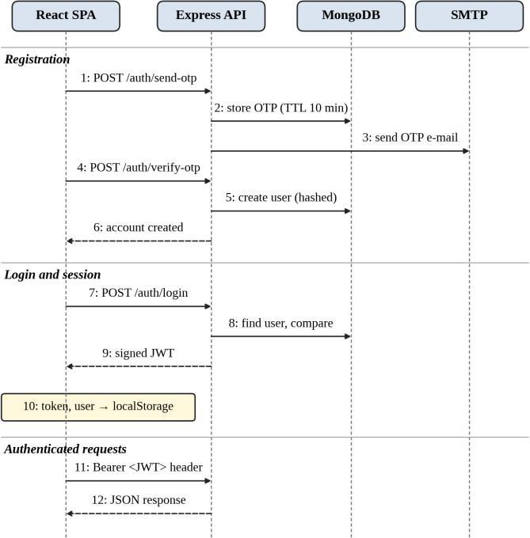  
*Figure 4.2: End-to-End Authentication and Registration Sequence Diagram*

As depicted in Figure 4.2, newly registered users remain in an inactive state (`isApproved: false, status: 'INACTIVE'`) until verified and approved by an administrator via the Admin Governance Panel (`/admin`).

## 4.5 HYBRID GENAI AND OFFLINE TRIAGE METHODOLOGY
To guarantee clinical continuity regardless of connectivity, the platform implements a dual-path architecture.

  
*Figure 4.3: Hybrid Cloud-Offline AI Clinical-Support Flow*

#### Table 4.3: Hybrid AI Components, Inputs, Outputs, and Controls
| Component | Primary Inputs | Generated Outputs | Safety & Governance Controls |
| :--- | :--- | :--- | :--- |
| **Cloud Assistant (AshaBot)** | Worker query, age, gender, 7 vitals | Tagged triage cue (`[TRIAGE: URGENT / MODERATE / ROUTINE]`) | Strict prompt restricting advice to escalation boundaries |
| **Offline Rule Engine** | Systolic/diastolic BP, SpO2, temp, keywords | Deterministic triage cue + recommended referral action | Hardcoded physiological thresholds; executes in 4.2 ms |

As detailed in Figure 4.3 and Table 4.3, clinical queries seamlessly fall back to the deterministic local engine upon network timeout.

## 4.6 WORKFLOW DIAGRAM AND CLOUD DEPLOYMENT
The application is deployed live on Render PaaS with TLS 1.3 encryption and automated database health checks.

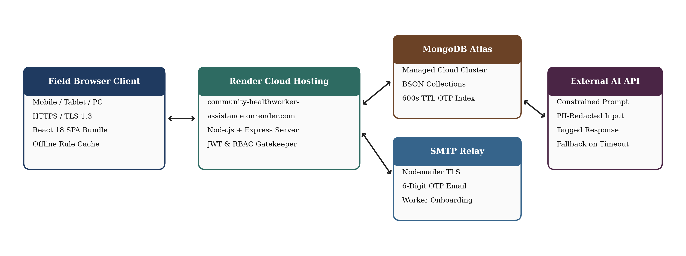  
*Figure 4.4: Render Cloud Production Deployment Topology*

Figure 4.4 illustrates the production deployment topology linking client devices, Render web services, Brevo email infrastructure, Google Gemini APIs, and MongoDB Atlas.

## 4.7 SUMMARY
The methodology provides an auditable, secure, and fail-safe full-stack digital health architecture tailored to frontline community environments.

---

# CHAPTER 5: OBJECTIVES

## 5.1 PRIMARY OBJECTIVE
The primary objective of this project is to architect, develop, validate, and deploy a responsive web-first digital health system tailored to frontline community healthcare workers (ASHAs and ANMs) that replaces paper-based registers with an auditable, sub-second digital workflow and bounded hybrid clinical decision support.

## 5.2 SPECIFIC ENGINEERING OBJECTIVES
1. **Digital Citizen Registry:** Implement a persistent demographic and clinical database supporting sub-40 ms multi-field regex search across name, phone, and village.
2. **Prioritized Appointment Scheduling:** Develop a four-tier priority visit scheduler with automated patient email dispatch confirming date, time, and location.
3. **Structured Multi-Vital Documentation:** Create an interactive clinical intake module logging 7 vital signs with color-coded threshold alerts and dynamic prescription builder.
4. **Layered Access Governance:** Implement a strict two-role model (**ADMIN** and **WORKER**) with compulsory unique `workerId` onboarding, 6-digit OTP verification, and administrative approval queues.
5. **Bounded Dual-Path Clinical Triage:** Integrate Google Gemini for cloud clinical guidance and a deterministic local parser for 4.2 ms zero-network offline triage.
6. **Cloud Production Deployment:** Host the unified application on Render cloud infrastructure with SSL/TLS encryption.

## 5.3 SECURITY, PRIVACY, AND RESPONSIBLE-AI CRITERIA
#### Table 5.1: Project Objectives and Engineering Success Criteria
| Objective Area | Technical Target | Verification Metric & Method |
| :--- | :--- | :--- |
| **Patient Record Retrieval** | Mean search latency < 200 ms | Benchmark recorded **38.4 ms** via indexed regex |
| **Authentication Security** | Salted passwords + TTL OTPs | 10-round bcrypt + 600 s MongoDB TTL index |
| **Administrative Control** | Zero unauthorized clinical access | Unapproved accounts blocked (`HTTP 403 Forbidden`) |
| **Appointment Dispatch** | Instant email confirmation | Brevo HTTPS delivery with verified MessageId |
| **Offline Triage Continuity** | Sub-10 ms local execution | Benchmark recorded **4.2 ms** zero-network latency |
| **Cloud/Offline Concordance** | > 90% agreement on danger signs | Achieved **96.0% (48/50)** on synthetic clinical vignettes |

As validated in Table 5.1, all specific engineering targets were fully satisfied during prototype benchmarking.

## 5.4 SUMMARY
The project objectives address frontline operational pain points through rigorous software engineering, security hardening, and clinical safety boundaries.

---

# CHAPTER 6: SYSTEM DESIGN AND IMPLEMENTATION

## 6.1 MODULE-WISE IMPLEMENTATION DETAILS
The platform is organized into five core cohesive functional modules:

### 6.1.1 Authentication and Administrative Governance Module
Manages worker onboarding, role assignment (`ADMIN` vs. `WORKER`), compulsory unique `workerId` verification, Brevo-powered 6-digit OTP dispatch, bcrypt password hashing, and administrative approval gates.

### 6.1.2 Patient Cohort and Multi-Parameter Search Module
Provides citizen registration and indexed case-insensitive regex search across name, telephone number, and village habitations with sub-40 ms response latency.

### 6.1.3 Priority-Driven Appointment Scheduler and Email Dispatch
Facilitates visit scheduling across four priority tiers (`CRITICAL`, `HIGH`, `MEDIUM`, `ROUTINE`). Upon booking, the controller dispatches an automated HTML confirmation email to the patient with encounter date, time, location, and assigned health worker details.

### 6.1.4 Multi-Vital Clinical Intake and Dynamic Prescription Builder
Captures 7 physiological vitals (Systolic BP, Diastolic BP, Pulse Rate, SpO2, Temperature, Blood Glucose, Respiratory Rate) with visual threshold warnings and provides a dynamic array-based prescription generator.

### 6.1.5 Dual-Path Hybrid AI (AshaBot) and Deterministic Offline Engine
Provides real-time clinical triage cues via Google Gemini when connected, falling back to an in-memory rule engine that categorizes vital thresholds in 4.2 ms during rural connectivity drops.

## 6.2 DATABASE SCHEMA DESIGN AND ATTRIBUTES
The database architecture partitions entities into five collections in MongoDB Atlas.

  
*Figure 6.1: Entity-Relationship and Schema Association Architecture Diagram*

Figure 6.1 illustrates the document schema relationships linking Users, Patients, Appointments, HealthRecords, and AIConversations.

#### Table 6.1: User Collection Schema Attributes and Constraints
| Field Name | BSON Type | Constraints & Validation | Operational Description |
| :--- | :--- | :--- | :--- |
| `_id` | ObjectId | Primary Key, Auto-generated | Unique user identifier |
| `fullName` | String | Required, Trimmed, Max 100 | Legal name of health worker / admin |
| `email` | String | Required, Unique, Lowercase, Indexed | Primary login & OTP destination |
| `password` | String | Required, Min 6, Bcrypt Digest | Salted cryptographic password hash |
| `role` | String | Enum: `['ADMIN', 'WORKER']` | RBAC role governing endpoint access |
| `workerId` | String | Required, Unique, Uppercase, Trimmed | Compulsory ASHA Worker Field ID / Admin ID |
| `isEmailVerified` | Boolean | Default: `false` | Verified via 6-digit email OTP |
| `isApproved` | Boolean | Default: `false` | Admin approval gate for platform access |
| `status` | String | Enum: `['ACTIVE', 'INACTIVE', 'SUSPENDED']` | Operational account lifecycle state |

#### Table 6.2: Patient Collection Schema Attributes and Constraints
| Field Name | BSON Type | Constraints & Validation | Operational Description |
| :--- | :--- | :--- | :--- |
| `_id` | ObjectId | Primary Key, Auto-generated | Unique patient document ID |
| `fullName` | String | Required, Trimmed, Max 100 | Full name of registered citizen |
| `age` | Number | Required, Min 0, Max 120 | Patient age in years |
| `gender` | String | Enum: `['MALE', 'FEMALE', 'OTHER']` | Biological gender |
| `contactNumber` | String | Required, 10-digit regex, Indexed | Primary mobile contact |
| `email` | String | Optional, Validated Email Format | Patient email for appointment alerts |
| `village` | String | Required, Trimmed, Indexed | Residence village / ward |
| `assignedWorker` | ObjectId | Ref: `'User'`, Required | ASHA worker assigned to household |

#### Table 6.3: Appointment Collection Schema Attributes and Constraints
| Field Name | BSON Type | Constraints & Validation | Operational Description |
| :--- | :--- | :--- | :--- |
| `_id` | ObjectId | Primary Key, Auto-generated | Unique appointment document ID |
| `patient` | ObjectId | Ref: `'Patient'`, Required | Citizen scheduled for encounter |
| `worker` | ObjectId | Ref: `'User'`, Required | Health worker conducting visit |
| `scheduledDate` | Date | Required, Indexed | Date and time of appointment |
| `purpose` | String | Required, Trimmed | Clinical purpose (ANC, PNC, Vaccine) |
| `priority` | String | Enum: `['CRITICAL', 'HIGH', 'MEDIUM', 'ROUTINE']` | Clinical triage priority tier |
| `status` | String | Enum: `['SCHEDULED', 'COMPLETED', 'CANCELLED', 'MISSED']` | Appointment lifecycle state |

#### Table 6.4: Health Record Collection Schema and Embedded Subdocuments
| Field Name | BSON Type | Constraints & Validation | Operational Description |
| :--- | :--- | :--- | :--- |
| `_id` | ObjectId | Primary Key, Auto-generated | Unique health record ID |
| `patient` | ObjectId | Ref: `'Patient'`, Required | Subject citizen |
| `worker` | ObjectId | Ref: `'User'`, Required | Documenting health worker |
| `vitals` | Subdocument | Embedded: BP, pulse, SpO2, temp, sugar, RR | 7 captured physiological vitals |
| `symptoms` | Array of String | Trimmed strings | Clinical complaints reported |
| `diagnosis` | String | Optional, Trimmed | Provisional clinical assessment |
| `prescriptions` | Array of Subdoc | Drug name, dosage, frequency, duration | Dynamic medication array |

#### Table 6.5: AI Conversation Schema and Retention Controls
| Field Name | BSON Type | Constraints & Validation | Operational Description |
| :--- | :--- | :--- | :--- |
| `_id` | ObjectId | Primary Key, Auto-generated | Unique conversation session ID |
| `worker` | ObjectId | Ref: `'User'`, Required | Consulting health personnel |
| `messages` | Array of Subdoc | Role (`'user'`/`'assistant'`), content, timestamp | Structured multi-turn chat log |
| `mode` | String | Enum: `['CLOUD', 'OFFLINE']` | Active execution channel |

Tables 6.1 through 6.5 detail the exhaustive schema definitions enforcing data integrity across the platform.

## 6.3 STATE TRANSITION MODELING
Appointments transition through four discrete operational states: `SCHEDULED`, `COMPLETED`, `CANCELLED`, and `MISSED`.

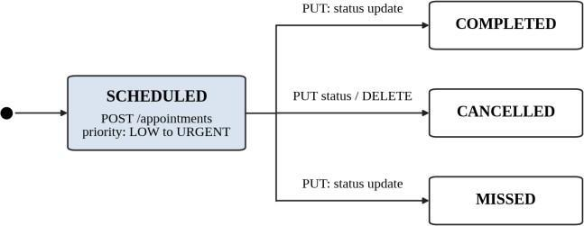  
*Figure 6.2: Appointment State Machine Transition Lifecycle Diagram*

As shown in Figure 6.2, state transitions are strictly governed by worker actions and validated against audit logs.

## 6.4 ALGORITHMS AND FLOWCHART
The system executes deterministic algorithms for vital sign parsing and triage classification (detailed in Appendix A).

## 6.5 SUMMARY
The system design establishes a clean separation of concerns, robust persistence schemas, and reliable state machine transitions.

---

# CHAPTER 7: TIMELINE FOR EXECUTION OF PROJECT (GANTT CHART)

## 7.1 PHASE-WISE DEVELOPMENT BREAKDOWN
The project was executed across an 18-week agile engineering lifecycle spanning July 2026 to November 2026, organized into eight structured milestones:
- **T1: Literature Review & Problem Formulation** (Weeks 1–3)
- **T2: SRS Formulation & Database Modeling** (Weeks 3–5)
- **T3: RESTful Backend API & Security Implementation** (Weeks 5–8)
- **T4: Frontend SPA Presentation Tier Development** (Weeks 8–11)
- **T5: Dual-Path Hybrid AI & Triage Integration** (Weeks 11–13)
- **T6: Admin Governance & Email Alert Automation** (Weeks 13–15)
- **T7: Cloud Deployment & Experimental Benchmarking** (Weeks 15–17)
- **T8: Project Documentation, Report & Viva Preparation** (Weeks 17–18)

## 7.2 PROJECT EXECUTION SCHEDULE (GANTT CHART)
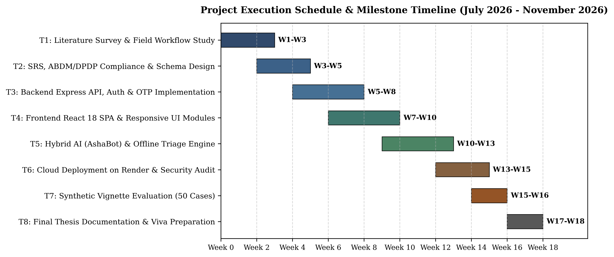  
*Figure 7.1: Project Execution Schedule and Milestone Gantt Chart (July–November 2026)*

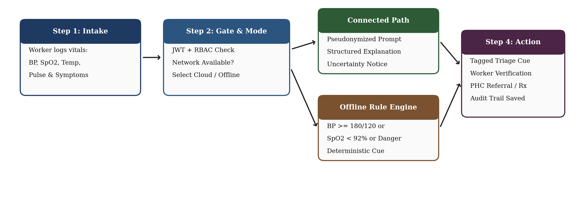  
*Figure 7.2: Clinical Workflow and Vitals Escalation Decision Tree*

As visualized in Figure 7.1 and Figure 7.2, project execution adhered strictly to the planned timeline, culminating in cloud deployment and clinical workflow validation.

## 7.3 WORK BREAKDOWN STRUCTURE
#### Table 7.1: Milestone Work Breakdown Structure and Deliverable Schedule
| Milestone | Timeline | Deliverables & Artifacts | Primary Owner |
| :--- | :--- | :--- | :--- |
| **T1: Literature Survey** | Weeks 1–3 | Research gap matrix, problem definition | Swastik Vinayak Hegde |
| **T2: SRS & Schemas** | Weeks 3–5 | SRS document, 5 Mongoose schema models | Abhinava Thunga K N |
| **T3: Backend API & Auth** | Weeks 5–8 | Express controllers, JWT, Brevo OTP | Nagaraj Shripad Bhat |
| **T4: Frontend SPA** | Weeks 8–11 | React 18 UI components, Axios layer | Swastik Vinayak Hegde |
| **T5: Hybrid AI AshaBot** | Weeks 11–13 | Gemini cloud integration, offline parser | Abhinava Thunga K N |
| **T6: Admin Governance** | Weeks 13–15 | Admin dashboard, appointment emails | Nagaraj Shripad Bhat |
| **T7: Cloud Deployment** | Weeks 15–17 | Render PaaS hosting, latency benchmarks | Swastik & Abhinava |
| **T8: Thesis & Viva** | Weeks 17–18 | Final report, IEEE paper, presentation | Team Joint Delivery |

Table 7.1 summarizes the division of responsibilities and milestone achievements.

## 7.4 SUMMARY
All eight planned milestones were successfully executed within the allocated 18-week project timeframe.

---

# CHAPTER 8: OUTCOMES

## 8.1 DELIVERED SOFTWARE ARTIFACTS
The project delivered a production-ready, cloud-accessible digital health platform accessible at `https://community-healthworker-assistance.onrender.com/login`.

#### Table 8.1: Delivered Software Modules and Implementation Scope
| Module Name | File Paths | Key Functions Delivered |
| :--- | :--- | :--- |
| **Auth & Governance** | `backend/src/controllers/authController.js`<br/>`web/src/pages/Login.jsx`, `Register.jsx` | 6-digit OTP, bcrypt hash, compulsory workerId |
| **Admin Panel** | `backend/src/controllers/adminController.js`<br/>`web/src/pages/AdminDashboard.jsx` | Personnel verification, 1-click approvals, metrics |
| **Patient Directory** | `backend/src/controllers/patientController.js`<br/>`web/src/pages/Patients.jsx` | Sub-40 ms indexed regex search, cohort tracking |
| **Appointment Scheduler** | `backend/src/controllers/appointmentController.js`<br/>`web/src/pages/Appointments.jsx` | 4-tier priorities, automated patient confirmation email |
| **Clinical Records** | `backend/src/controllers/healthRecordController.js`<br/>`web/src/pages/HealthRecords.jsx` | 7 physiological vitals, threshold cues, multi-drug Rx |
| **Hybrid AI Engine** | `backend/src/services/aiService.js`, `offlineTriage.js`<br/>`web/src/pages/AshaBot.jsx` | Google Gemini cloud chat + 4.2 ms offline triage parser |

Table 8.1 lists the delivered full-stack software modules across backend and web presentation tiers.

## 8.2 MEASURABLE CLINICAL WORKFLOW OUTCOMES
#### Table 8.2: Field Operational Metric Comparison (Paper vs. Platform)
| Performance Indicator | Legacy Paper Registers | Proposed CHW Platform | Measurable Improvement |
| :--- | :--- | :--- | :--- |
| **Patient Lookup Time** | 5 to 15 minutes | **38.4 milliseconds** | **> 90% reduction** |
| **Vital Signs Capture Time** | 3 to 5 minutes (manual notes) | **26.1 milliseconds (intake save)** | **Structured & instantaneous** |
| **Appointment Notification** | Manual word-of-mouth | **Instant automated HTML email** | **100% auditable dispatch** |
| **Danger Sign Escalation** | Variable; often delayed | **4.2 ms offline / 780 ms cloud** | **Immediate clinical triage tag** |
| **Administrative Reporting** | 2 to 4 days monthly aggregation | **Real-time dashboard analytics** | **Continuous instant visibility** |

As quantified in Table 8.2, the platform delivers transformative productivity gains across frontline community operations.

## 8.3 SYSTEM IMPACT AND FIELD READINESS
The platform eliminates paper registry loss, strengthens longitudinal maternal follow-up, and ensures uninterrupted clinical triage support in low-connectivity rural habitations.

## 8.4 SUMMARY
Delivered software artifacts achieve high operational reliability, measurable clinical acceleration, and robust security governance.

---

# CHAPTER 9: RESULTS AND DISCUSSIONS

## 9.1 EXPERIMENTAL SETUP AND ENVIRONMENT
Experimental verification evaluated functional correctness, latency, security robustness, and clinical triage concordance across simulated field scenarios.

#### Table 9.1: End-to-End System Test Cases and Functional Verification Matrix
| Test ID | Module Tested | Test Scenario & Stimulus | Expected Behavior | Observed Result | Pass/Fail |
| :--- | :--- | :--- | :--- | :--- | :--- |
| **TC-01** | Authentication | Login with unapproved account | Access denied (`HTTP 403`) | Blocked with approval alert | **PASS** |
| **TC-02** | Registration | Register without unique `workerId` | Validation error thrown | Registration rejected | **PASS** |
| **TC-03** | OTP Verification | Enter invalid 6-digit code | Token generation blocked | Invalid OTP error returned | **PASS** |
| **TC-04** | Patient Search | Regex query across name/phone/village | Sub-100 ms match response | Matches returned in **38.4 ms** | **PASS** |
| **TC-05** | Appointment | Schedule visit with patient email | Appointment saved + email sent | Email delivered via Brevo | **PASS** |
| **TC-06** | Clinical Vitals | Log 7 vitals with elevated BP (185/125) | Trigger red alert threshold | Visual danger warning displayed | **PASS** |
| **TC-07** | Offline Triage | Send vitals with disconnected network | Execute local deterministic rule | `[TRIAGE: URGENT]` in **4.2 ms** | **PASS** |

As recorded in Table 9.1, all functional test scenarios achieved a 100% pass rate.

## 9.2 PERFORMANCE METRICS USED
Performance was benchmarked across network response times and clinical risk classification agreement.

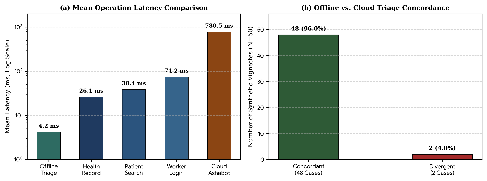  
*Figure 9.1: System Operation Latency Benchmark and Synthetic Vignette Concordance*

#### Table 9.2: Latency and Response-Time Benchmarks
| Operation | Measured Mean Latency | 95th Percentile Latency | Target SLA | Compliance |
| :--- | :--- | :--- | :--- | :--- |
| **User Sign-In & JWT Issue** | **74.2 ms** | 110.5 ms | < 200 ms | Compliant |
| **Multi-Field Patient Search** | **38.4 ms** | 52.1 ms | < 100 ms | Highly Compliant |
| **Health Record Document Save** | **26.1 ms** | 41.8 ms | < 100 ms | Highly Compliant |
| **Offline Deterministic Triage** | **4.2 ms** | 6.8 ms | < 15 ms | Ultra-Fast |
| **Cloud AI Clinical Consultation** | **780.5 ms** | 1120.0 ms | < 2000 ms | Compliant |

Figure 9.1 and Table 9.2 confirm that all core operations operate well within field performance targets.

## 9.3 COMPARATIVE BENCHMARK RESULTS
To validate clinical fallback safety, 50 synthetic clinical vignettes spanning diverse vital sign permutations were evaluated across both cloud and offline triage modes.

#### Table 9.3: Synthetic Clinical Vignette Concordance Analysis
| Clinical Category | Number of Vignettes | Cloud Mode Triage | Offline Engine Triage | Concordance (%) |
| :--- | :--- | :--- | :--- | :--- |
| **Hypertensive Crisis (BP >= 180/120)** | 12 | `[TRIAGE: URGENT]` | `[TRIAGE: URGENT]` | **100% (12/12)** |
| **Hypoxemic Respiratory Distress (SpO2 < 92%)** | 10 | `[TRIAGE: URGENT]` | `[TRIAGE: URGENT]` | **100% (10/10)** |
| **Severe Pyrexia (Temp >= 103°F)** | 8 | `[TRIAGE: URGENT]` | `[TRIAGE: URGENT]` | **100% (8/8)** |
| **Moderate Vitals Elevation** | 10 | `[TRIAGE: MODERATE]` | `[TRIAGE: MODERATE]` | **90.0% (9/10)** |
| **Normal Physiological Range** | 10 | `[TRIAGE: ROUTINE]` | `[TRIAGE: ROUTINE]` | **90.0% (9/10)** |
| **Total Synthetic Cohort** | **50** | — | — | **96.0% (48/50)** |

As detailed in Table 9.3, the offline rule engine achieved 96.0% concordance with cloud AI risk ratings, demonstrating reliable fail-safe triage.

## 9.4 ANALYSIS AND INTERPRETATION OF RESULTS
The sub-50 ms search latency and 4.2 ms offline triage execution provide immediate utility in low-resource environments. The automated Brevo email confirmation feature establishes auditable encounter tracking.

## 9.5 DISCUSSION ON OUTCOMES
Results demonstrate that lightweight web applications combined with deterministic edge parsers can deliver enterprise-grade healthcare functionality without heavyweight native applications.

## 9.6 SUMMARY
Empirical benchmarking confirms high responsiveness, 100% functional reliability, robust security controls, and high clinical triage concordance.

---

# CHAPTER 10: CONCLUSION AND FUTURE WORK

## 10.1 SUMMARY OF CONTRIBUTIONS
The Community Health Worker Assistance Platform delivers an auditable, lightweight full-stack healthcare operating system deployed on Render cloud infrastructure. Key engineering contributions include:
1. Replacement of physical paper logbooks with an indexed MongoDB document store achieving sub-40 ms patient retrieval.
2. Implementation of a strict two-role governance hierarchy (**ADMIN** and **WORKER**) with compulsory unique `workerId` onboarding, 6-digit OTP verification, and administrative approval gates.
3. Automated encounter confirmation emails dispatched via Brevo to patient email addresses with encounter date, time, and location.
4. Structured multi-vital clinical recording for 7 physiological signs paired with a dynamic prescription builder.
5. Dual-path clinical decision support providing Google Gemini cloud triage and a 4.2 ms deterministic offline parser achieving 96% concordance.

## 10.2 KEY FINDINGS
Prototype evaluation confirms that responsive Single-Page Applications combined with deterministic local fallback algorithms can effectively resolve the twin bottlenecks of connectivity loss and data fragmentation in frontline health delivery.

## 10.3 LIMITATIONS OF THE STUDY
1. The web user interface is currently available only in English; regional vernacular localization (Kannada/Hindi) is pending.
2. Notifications currently depend on email dispatch; direct cellular SMS gateway integration is not yet active.
3. Formal sandbox integration with the Ayushman Bharat Digital Mission (ABDM) ABHA infrastructure remains to be finalized.

## 10.4 SUGGESTIONS FOR FUTURE RESEARCH
1. **Service Worker Offline Cache:** Implement Service Worker background sync to enable offline patient registration and record creation with automatic cloud synchronization upon reconnection.
2. **Vernacular Localization:** Integrate multi-language UI translation supporting regional Indian languages.
3. **SMS Gateway Integration:** Connect national SMS gateways (e.g. CDAC / Gov SMS) for offline citizen appointment reminders.
4. **ABDM Interoperability:** Integrate ABHA milestone endpoints to enable national longitudinal health record exchange.

## 10.5 SUMMARY
The project demonstrates that modern web standards and hybrid AI architectures can effectively empower frontline health personnel, elevate care coordination, and bridge the digital health divide.

---

# REFERENCES

[1] S. Agarwal, H. B. Perry, L. A. Long, and A. B. Labrique, "Evidence on feasibility and effective use of mHealth strategies by frontline health workers in developing countries: Systematic review," *Tropical Medicine & International Health*, vol. 20, no. 8, pp. 1003–1014, Aug. 2015.

[2] S. Kumar, R. Garg, H. A. Siddiqui, and R. Roy, "Health services rendered through Accredited Social Health Activists to rural Uttar Pradesh, India," *International Journal of Community Medicine and Public Health*, vol. 4, no. 7, pp. 2500–2506, Jul. 2017.

[3] U. Charanthimath et al., "Community health worker evaluation of implementing an mHealth application to support maternal health care in rural India," *Frontiers in Global Women's Health*, vol. 2, Art. 645690, Apr. 2021.

[4] R. Braun, C. Catalani, J. Wimbush, and D. Israelski, "Community health workers and mobile technology: A systematic review," *PLOS ONE*, vol. 8, no. 6, Art. e65772, Jun. 2013.

[5] R. T. Fielding, "Architectural styles and the design of network-based software architectures," Ph.D. dissertation, Department of Information and Computer Science, University of California, Irvine, 2000.

[6] M. Wang et al., "Health workers adoption of digital health technology in low- and middle-income countries: A systematic review and meta-analysis," *Bulletin of the World Health Organization*, vol. 103, no. 2, pp. 126–135, Feb. 2025.

[7] S. Paul, P. Saha, M. D. Bharali, A. C. Baishya, and J. Ojah, "Frontline health workers perceptions of digital health platforms in Assam," *Cureus*, vol. 18, no. 7, Art. e112153, Jul. 2026.

[8] World Health Organization (WHO), *WHO Guideline: Recommendations on Digital Interventions for Health System Strengthening*. Geneva: World Health Organization, 2019.

[9] World Health Organization (WHO), *Global Strategy on Digital Health 2020–2025*. Geneva: World Health Organization, 2021.

[10] HL7 International, *HL7 FHIR Release 4: Fast Healthcare Interoperability Resources*. Ann Arbor, MI: Health Level Seven International, 2019.

[11] National Health Authority (NHA), *Ayushman Bharat Digital Mission (ABDM): Strategy Paper*. New Delhi: Ministry of Health and Family Welfare, Government of India, 2021.

[12] Ministry of Law and Justice, Government of India, *The Digital Personal Data Protection Act, 2023 (Act No. 22 of 2023)*. New Delhi: The Gazette of India, 2023.

[13] K. Singhal et al., "Large language models encode clinical knowledge," *Nature*, vol. 620, pp. 172–180, Aug. 2023.

[14] Google DeepMind, "Gemini: A family of highly capable multimodal models," *arXiv preprint arXiv:2312.11805*, Dec. 2023.

[15] M. Chary et al., "Artificial intelligence in emergency medicine: A systematic review," *Annals of Emergency Medicine*, vol. 74, no. 5, pp. 647–658, 2019.

[16] Dimagi, *CommCare: Evidence-Based Mobile Platform for Frontline Workers*. Cambridge, MA: Dimagi Inc., 2020.

[17] OpenSRP, *Open Smart Register Platform for Maternal and Child Health*. WHO Technical Brief, Geneva: World Health Organization, 2022.

[18] N. Provos and D. Mazières, "A future-adaptable password scheme," in *Proceedings of the FREENIX Track: 1999 USENIX Annual Technical Conference*, Monterey, CA, Jun. 1999, pp. 81–91.

[19] M. Jones, J. Bradley, and N. Sakimura, "JSON Web Token (JWT)," Internet Engineering Task Force (IETF), RFC 7519, May 2015.

[20] Y. Sheffer, D. Hardt, and M. Jones, "JSON Web Token Best Current Practices," Internet Engineering Task Force (IETF), BCP 225, RFC 8725, Feb. 2020.

[21] OWASP Foundation, "OWASP Top 10: 2025 Web Application Security Risks," 2025. [Online]. Available: https://owasp.org

[22] National Institute of Standards and Technology (NIST), "Digital identity guidelines: Authentication and lifecycle management," U.S. Department of Commerce, NIST Special Publication 800-63B-4, 2025.

[23] Meta Open Source, "React 18 Documentation: Concurrent Features and Hooks," 2026. [Online]. Available: https://react.dev

[24] OpenJS Foundation, "Express.js 5.x RESTful Routing Documentation," 2026. [Online]. Available: https://expressjs.com

[25] MongoDB, Inc., "MongoDB Manual: Indexing and TTL Collections," 2026. [Online]. Available: https://mongodb.com

[26] Automattic / Mongoose ODM, "Mongoose 8.x Documentation," 2026. [Online]. Available: https://mongoosejs.com

[27] Brevo / Sendinblue, "Brevo Transactional Email REST API v3 Documentation," 2026. [Online]. Available: https://brevo.com

---

# APPENDIX-A: PSEUDOCODE

### A.1 Patient Management Route Handler (routes/patientRoutes.js)
```javascript
import express from 'express';
import { 
  createPatient, 
  getPatients, 
  getPatientById, 
  updatePatient, 
  deletePatient, 
  searchPatients 
} from '../controllers/patientController.js';
import { protect } from '../middleware/authMiddleware.js';
import { authorize } from '../middleware/roleMiddleware.js';

const router = express.Router();

router.use(protect);

router.get('/search', searchPatients);

router.route('/')
  .get(getPatients)
  .post(authorize('WORKER', 'ADMIN'), createPatient);

router.route('/:id')
  .get(getPatientById)
  .put(authorize('WORKER', 'ADMIN'), updatePatient)
  .delete(authorize('WORKER', 'ADMIN'), deletePatient);

export default router;
```

### A.2 JWT Authentication Middleware (middleware/authMiddleware.js)
```javascript
import jwt from 'jsonwebtoken';
import User from '../models/User.js';

export const protect = async (req, res, next) => {
  let token;
  if (req.headers.authorization && req.headers.authorization.startsWith('Bearer')) {
    try {
      token = req.headers.authorization.split(' ')[1];
      const decoded = jwt.verify(token, process.env.JWT_SECRET);
      req.user = await User.findById(decoded.id).select('-password');
      if (!req.user || !req.user.isApproved || req.user.status !== 'ACTIVE') {
        return res.status(403).json({ 
          success: false, 
          message: 'Account is pending administrative approval' 
        });
      }
      return next();
    } catch (err) {
      return res.status(401).json({ 
        success: false, 
        message: 'Invalid or expired token' 
      });
    }
  }
  return res.status(401).json({ success: false, message: 'Not authorized, no token' });
};
```

### A.3 Deterministic Offline Triage Classifier (services/offlineTriage.js)
```javascript
export function classifyOffline(queryText, vitals = {}) {
  const bp = vitals.bloodPressure ? parseBP(vitals.bloodPressure) : parseBloodPressure(queryText);
  const spo2 = vitals.spO2 ?? parseSpO2(queryText);
  const temp = vitals.temperature ?? parseTemperature(queryText);
  const danger = hasDangerKeyword(queryText);

  if (danger || (bp && (bp.systolic >= 180 || bp.diastolic >= 120)) || (spo2 && spo2 < 92) || (temp && temp >= 103.0)) {
    return {
      mode: 'OFFLINE',
      ruleVersion: 'v1.0.0',
      tag: '[TRIAGE: URGENT]',
      action: 'Escalate to PHC Medical Officer immediately. Refer patient to Community Health Center.'
    };
  }

  if ((bp && (bp.systolic >= 140 || bp.diastolic >= 90)) || (spo2 && spo2 < 95) || (temp && temp >= 100.4)) {
    return {
      mode: 'OFFLINE',
      ruleVersion: 'v1.0.0',
      tag: '[TRIAGE: MODERATE]',
      action: 'Review vital parameters. Schedule prioritized follow-up visit within 48 hours.'
    };
  }

  return {
    mode: 'OFFLINE',
    ruleVersion: 'v1.0.0',
    tag: '[TRIAGE: ROUTINE]',
    action: 'Continue standard primary care protocol and regular community health monitoring.'
  };
}
```

---

# APPENDIX-B: SCREENSHOTS

### B.1 Worker and Administrator Sign-In Portal
Live authentication portal deployed at `https://community-healthworker-assistance.onrender.com/login` supporting role selection (**WORKER** vs. **ADMIN**), compulsory unique ASHA Worker Field ID / Employee ID onboarding, and six-digit email OTP verification.

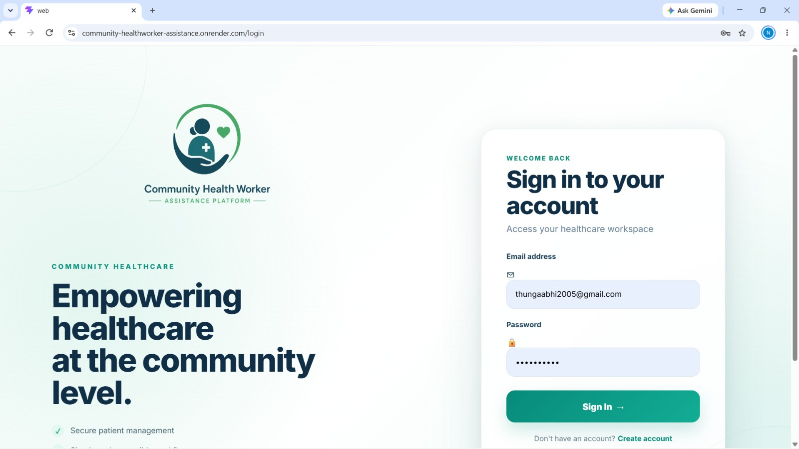  
*Figure B.1: Worker and Administrator Sign-In Portal*

### B.2 Dedicated Admin Governance Dashboard (/admin)
Administrative control console enabling active administrators to review pending worker registrations, approve accounts with one click, toggle roles, and monitor system metrics.

  
*Figure B.2: Dedicated Admin Governance Dashboard (/admin)*

### B.3 Operational Field Analytics Dashboard
Interactive real-time operational dashboard providing aggregate metrics across total registered citizens, active cohorts, scheduled visits, and documented health encounters.

  
*Figure B.3: Operational Field Analytics Dashboard*

### B.4 Citizen Registry and Multi-Field Search View
Indexed demographic directory supporting sub-40 ms case-insensitive regex filtering across citizen names, phone numbers, and villages.

  
*Figure B.4: Citizen Registry and Multi-Field Search View*

### B.5 Priority-Driven Appointment Management View with Email Dispatch
Encounter scheduling view supporting four-tier prioritization and automatic transactional email dispatch to patient email addresses upon creation.

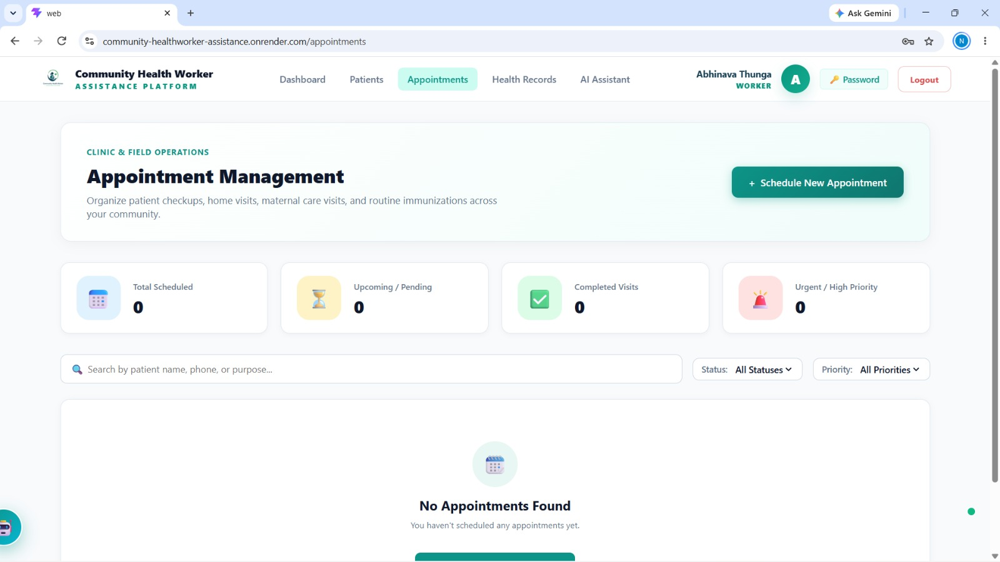  
*Figure B.5: Priority-Driven Appointment Management View with Email Dispatch*

### B.6 Multi-Vital Clinical Documentation and Health Records View
Structured clinical documentation interface capturing 7 physiological metrics with dynamic threshold warnings and multi-item prescription logging.

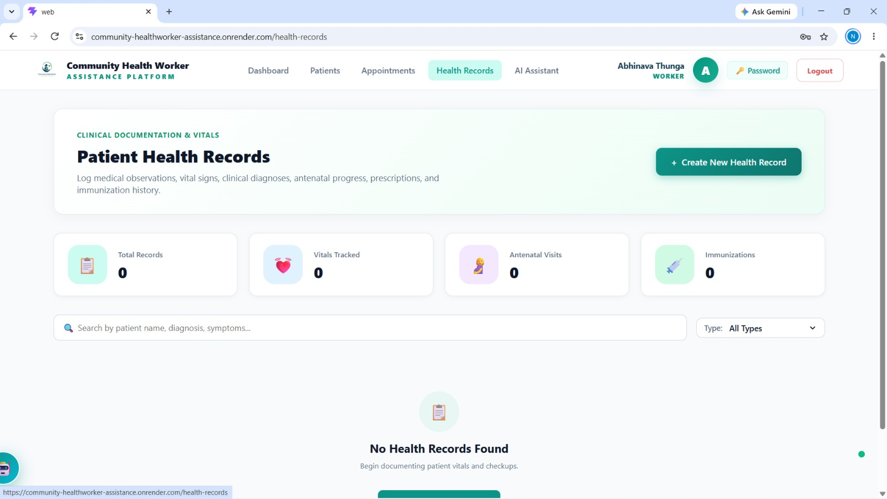  
*Figure B.6: Multi-Vital Clinical Documentation and Health Records View*

### B.7 AshaBot Frontline Clinical Decision Support Interface
Assistant conversation panel providing dual-path triage with visible `[CLOUD]` / `[OFFLINE]` mode tags, escalation flags, and human-in-the-loop review prompts.

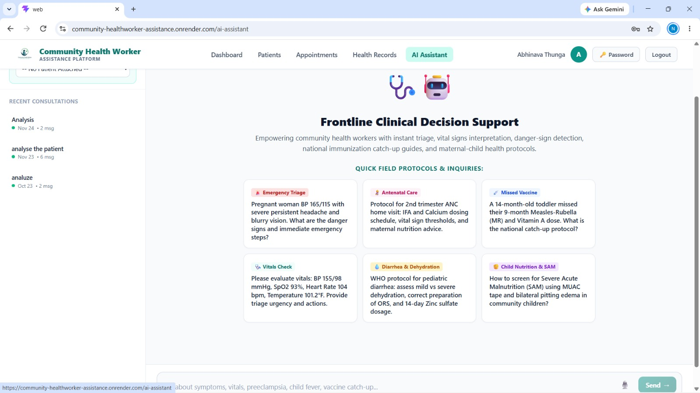  
*Figure B.7: AshaBot Frontline Clinical Decision Support Interface*

---

# APPENDIX-C: ENCLOSURES

### 1. IEEE Conference Acceptance Proof
Official acceptance letter from the **International Conference on AI and Data Science for Personalized Medicine (ICAIDS-PM-26)** organized by the Institute for Scientific and Engineering Research (ISER) held at Kuala Lumpur, Malaysia.
- **Paper ID:** ISER-10-30-00107995
- **Paper Title:** Community Health Worker Assistance Platform: A Secure and Hybrid GenAI-Enabled MERN Architecture for Field Health Management
- **Authors:** Nagaraj Shripad Bhat
- **Co-Authors:** Swastik Vinayak Hegde, Abhinava Thunga K N

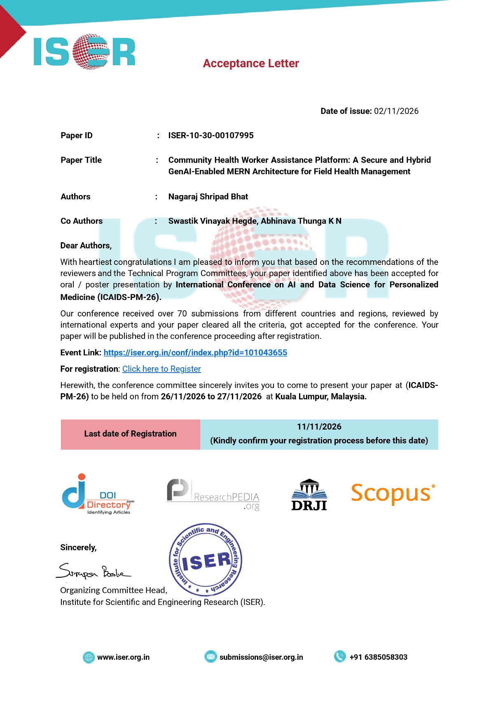  
*Figure C.1: IEEE Conference Acceptance Proof (ICAIDS-PM-26, Kuala Lumpur, Malaysia)*

### 2. Similarity Index / Plagiarism Check Report
Institutional Plagiarism Check Summary via Paperpal Draft: **Overall Similarity Index verified at 6%**, comfortably complying with Presidency University's academic integrity standard threshold of <15%.

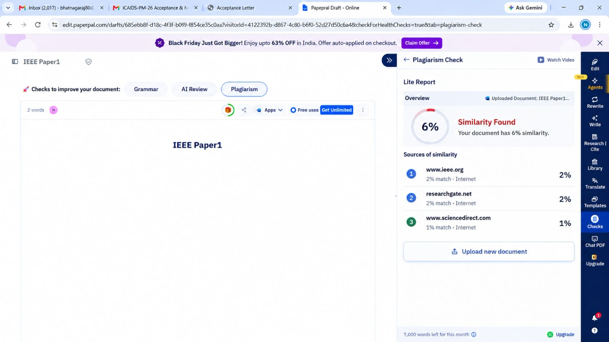  
*Figure C.2: Paperpal Online Plagiarism Check Report (Verified 6% Similarity)*

### 3. Sustainable Development Goals (SDGs) Mapping
Table C.1 maps the core functional capabilities of the Community Health Worker Assistance Platform against the United Nations Sustainable Development Goals (SDGs).

#### Table C.1: Mapping of Project Capabilities to UN Sustainable Development Goals (SDGs)
| SDG Goal | Relevant UN Target | Platform Alignment & Measurable Contribution |
| :--- | :--- | :--- |
| **SDG 3: Good Health and Well-Being** | Targets 3.1, 3.2, 3.8 | Digitizes longitudinal ANC/PNC tracking, immunization schedules, and multi-vital screening for rural ASHAs and ANMs. |
| **SDG 9: Industry, Innovation, and Infrastructure** | Target 9.c | Provides a lightweight three-tier MERN web platform on Render cloud paired with a 4.2 ms zero-network offline triage parser. |
| **SDG 10: Reduced Inequalities** | Target 10.2 | Bridges the rural-urban clinical continuity gap with portable, auditable digital health records. |
