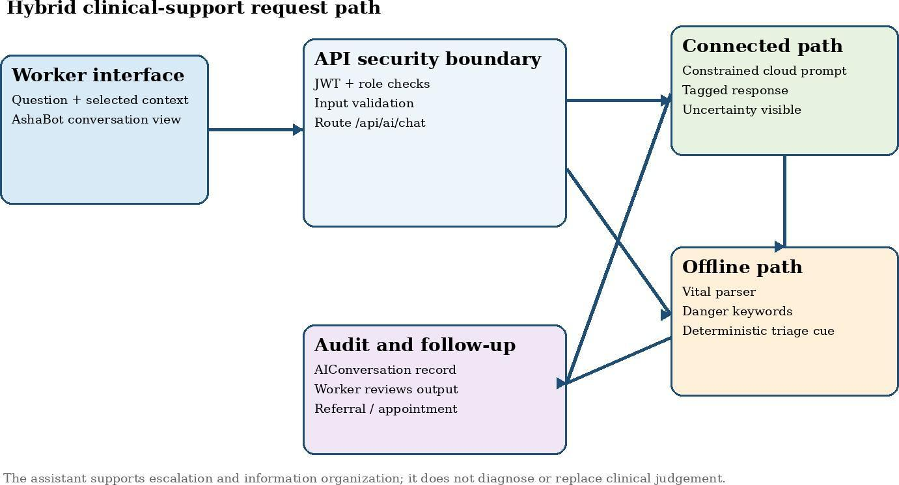
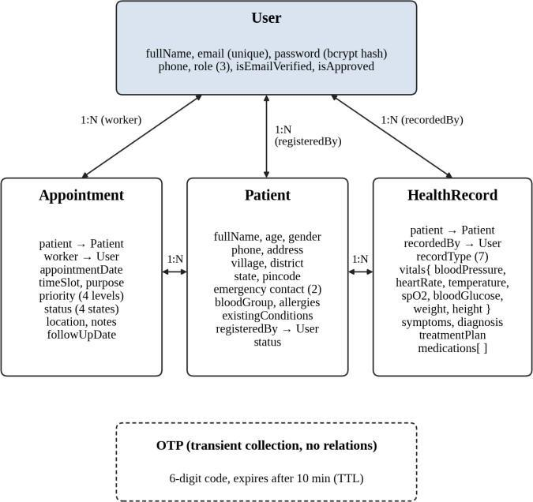
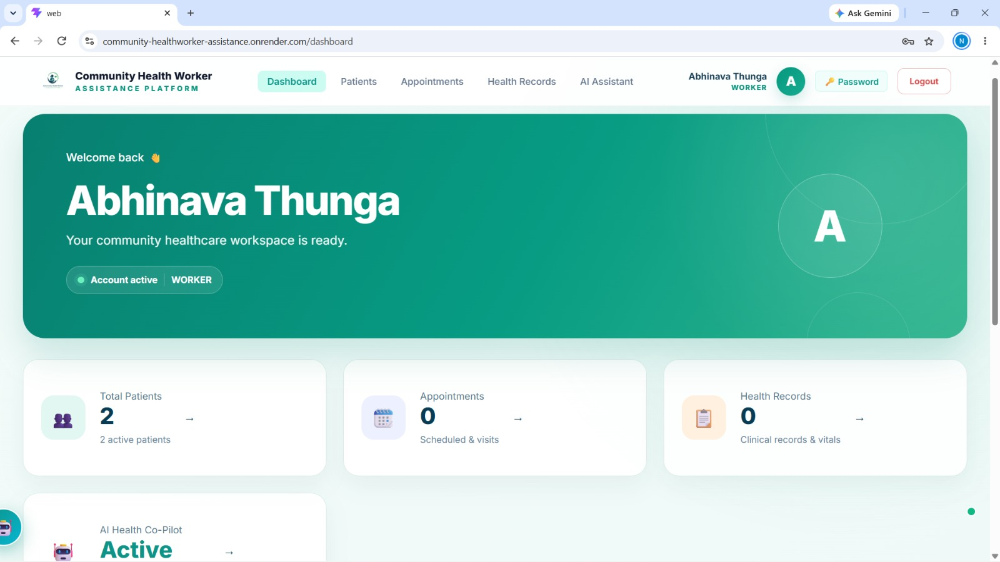
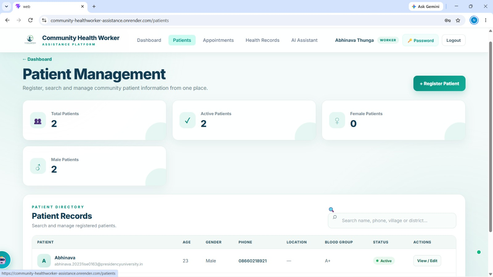

# PRESIDENCY UNIVERSITY
**Private University Estd. in Karnataka State by Act No. 41 of 2013**  
*Itgalpura, Rajankunte, Yelahanka, Bengaluru – 560064*  
**PRESIDENCY SCHOOL OF COMPUTER SCIENCE AND ENGINEERING**

---

# COMMUNITY HEALTH WORKER ASSISTANCE PLATFORM
### A PROJECT REPORT

Submitted in partial fulfillment of the requirements for the award of the degree of  
**BACHELOR OF TECHNOLOGY IN INFORMATION SCIENCE AND ENGINEERING**

**Submitted by:**
- **SWASTIK VINAYAK HEGDE** — 20231ISE0153
- **ABHINAVA THUNGA K N** — 20231ISE0163
- **NAGARAJ SHRIPAD BHAT** — 20231ISE0166

**Under the guidance of:**  
**Mr. HRITIK KUMAR**  
Assistant Professor, Department of Information Science and Engineering  
Presidency School of Computer Science and Engineering  
Presidency University, Bengaluru

**DECEMBER 2026**

---

## PRESIDENCY SCHOOL OF COMPUTER SCIENCE AND ENGINEERING
### BONAFIDE CERTIFICATE

Certified that this report titled **“Community Health Worker Assistance Platform”** is a bonafide work carried out by **Mr. Swastik Vinayak Hegde (20231ISE0153)**, **Mr. Abhinava Thunga K N (20231ISE0163)**, and **Mr. Nagaraj Shripad Bhat (20231ISE0166)**, who have successfully carried out the project work and submitted the report for partial fulfillment of the requirements for the award of the degree of **BACHELOR OF TECHNOLOGY in INFORMATION SCIENCE AND ENGINEERING** during the academic year 2026–27.

| **Mr. Hritik Kumar** | **Ms. Sumita Guddin** | **Dr. Gopal K Shyam** |
| :--- | :--- | :--- |
| Project Guide, PSCS | Program Project Coordinator, PSCS | Head of the Department, PSCS |
| Presidency University | Presidency University | Presidency University |

---

## PRESIDENCY SCHOOL OF COMPUTER SCIENCE AND ENGINEERING
### CERTIFICATE OF VIVA-VOCE-EXAMINATION

This is to certify that **Mr. Swastik Vinayak Hegde (20231ISE0153)**, **Mr. Abhinava Thunga K N (20231ISE0163)**, and **Mr. Nagaraj Shripad Bhat (20231ISE0166)** have been subjected to the Viva-voce Examination on **03-12-2026** at Presidency University, Bengaluru.

| **Examiner-1** | **Examiner-2** |
| :--- | :--- |
| **Name:** | **Name:** |
| **Designation:** | **Designation:** |
| **University/College:** | **University/College:** |

---

## DECLARATION

We, the students of final year B.Tech in **INFORMATION SCIENCE AND ENGINEERING**, at Presidency University, Bengaluru, named **SWASTIK VINAYAK HEGDE (20231ISE0153)**, **ABHINAVA THUNGA K N (20231ISE0163)**, and **NAGARAJ SHRIPAD BHAT (20231ISE0166)**, hereby declare that the project work titled **“COMMUNITY HEALTH WORKER ASSISTANCE PLATFORM”** has been independently carried out by us and submitted in partial fulfillment for the award of the degree of **B.Tech in INFORMATION SCIENCE AND ENGINEERING** during the academic year 2026–27. Further, the matter embodied in the project has not been submitted previously by anybody for the award of any Degree or Diploma to any other institution.

- **Swastik Vinayak Hegde** — 20231ISE0153  
- **Abhinava Thunga K N** — 20231ISE0163  
- **Nagaraj Shripad Bhat** — 20231ISE0166  

**PLACE:** BENGALURU  
**DATE:** DECEMBER 2026  

---

## ACKNOWLEDGEMENT

For completing this project work, we have received the support and the guidance from many people whom we would like to mention with deep sense of gratitude and indebtedness. We extend our gratitude to our beloved **Chancellor**, **Vice Chancellor**, **Pro-Vice Chancellor**, and **Registrar** for their support and encouragement in completion of the project.

We express our cordial thanks to **Dr. Duraipandian N**, Dean PSCS, Presidency School of Computer Science and Engineering and the Management of Presidency University for providing the required facilities and intellectually stimulating environment that aided in the completion of our project work.

We are also thankful to **Dr. Gopal K Shyam**, Professor, Head of the Department, Presidency School of Computer Science and Engineering, Presidency University, for his mentorship and encouragement.

We would like to sincerely thank our internal guide **Mr. Hritik Kumar**, Assistant Professor, Presidency School of Computer Science and Engineering, Presidency University, for his moral support, motivation, timely guidance, and encouragement provided to us during the period of our project work.

We are grateful to **Mr. Muthuraju V**, School Project Coordinator, and **Ms. Sumita Guddin**, Program Project Coordinator, Presidency School of Computer Science and Engineering, for facilitating problem statements, coordinating reviews, monitoring progress, and providing their valuable support and guidance.

We are also grateful to the Teaching and Non-Teaching staff of Presidency School of Computer Science and Engineering and also staff from other departments who have extended their valuable help and cooperation.

**SWASTIK VINAYAK HEGDE**  
**ABHINAVA THUNGA K N**  
**NAGARAJ SHRIPAD BHAT**  

---

## ABSTRACT

Frontline community healthcare workers, predominantly Accredited Social Health Activists (ASHAs) and Auxiliary Nurse Midwives (ANMs) operating within primary-health ecosystems in India, coordinate maternal care, immunization, chronic-disease follow-up, and household visits under significant time and connectivity constraints. Paper registers and fragmented notebooks make patient retrieval slow, weaken longitudinal follow-up, and delay the recognition of danger signs. This project presents the **Community Health Worker (CHW) Assistance Platform**, a responsive web-first digital health system designed around field workflows and deployed as a cloud-accessible web application (`https://community-healthworker-assistance.onrender.com/login`). The platform uses a three-tier MERN architecture consisting of a React 18 single-page application, an Express and Node.js service tier, and MongoDB persistence through Mongoose.

The report extends the original registry and scheduling prototype with a hybrid clinical-support layer. When connectivity is available, a constrained cloud assistant, referred to in the interface as **AshaBot**, receives the worker's question and minimum necessary patient context and returns a tagged, uncertainty-aware response. When the cloud path is unavailable, a deterministic local engine parses supported vital signs and danger-sign keywords and produces an urgent, moderate, or routine escalation cue without a network round trip. The security model combines email-based six-digit OTP verification, bcrypt password hashing, JWT bearer authentication, role checks, rate limiting, and schema validation. The application supports patient search, prioritized appointments, structured multi-vital health records, prescriptions, dashboard analytics, and protected AI conversations. Prototype measurements supplied with the project recorded mean latencies of 74.2 ms for login, 38.4 ms for multi-field search, 26.1 ms for health-record creation, 4.2 ms for offline triage, and 780.5 ms for cloud consultation; the local engine agreed with the cloud risk category in 48 of 50 synthetic vignettes. These results demonstrate engineering feasibility only. They do not establish diagnostic accuracy, clinical safety, health-outcome benefit, or suitability for unsupervised deployment.

---

## TABLE OF CONTENTS

| CHAPTER NO | TITLE | PAGE NO |
| :--- | :--- | :--- |
| | **ABSTRACT** | v |
| | **TABLE OF CONTENTS** | vi |
| | **LIST OF FIGURES** | ix |
| | **LIST OF TABLES** | x |
| | **ABBREVIATIONS** | xi |
| **1.** | **INTRODUCTION** | **1** |
| | 1.1 Background and Domain Context | 1 |
| | 1.2 Problem Statement and Clinical Bottlenecks | 1 |
| | 1.3 Project Motivation and Target Beneficiaries | 3 |
| | 1.4 Scope and Delimitations of the Work | 4 |
| | 1.5 Organization of the Report | 4 |
| **2.** | **LITERATURE SURVEY** | **6** |
| | 2.1 Evolution of Frontline mHealth Interventions | 6 |
| | 2.2 Critical Appraisal of Contemporary Works | 6 |
| | 2.3 International Guidelines and Digital Health Standards | 8 |
| | 2.4 National Healthcare Informatics Frameworks (ABDM & DPDP Act) | 8 |
| | 2.5 AI-Assisted Clinical Support: Design Opportunity | 9 |
| | 2.6 Summary of Literature Review | 10 |
| **3.** | **RESEARCH GAPS OF EXISTING METHODS** | **11** |
| | 3.1 Introduction | 11 |
| | 3.2 Structural and Architectural Deficiencies | 11 |
| | 3.3 Clinical Workflow and Vitals Integration Gaps | 11 |
| | 3.4 Connectivity, Latency, and AI Safety Boundaries | 12 |
| | 3.5 Comparative Gap Analysis | 12 |
| **4.** | **PROPOSED METHODOLOGY** | **13** |
| | 4.1 Introduction | 13 |
| | 4.2 Software Requirements Specification (SRS) | 13 |
| | 4.2.1 Functional Requirements | 13 |
| | 4.2.2 Non-Functional Requirements | 13 |
| | 4.3 System Engineering Environment and Tooling | 14 |
| | 4.4 High-Level Three-Tier Architecture | 16 |
| | 4.5 Operational Security and Authentication Architecture | 17 |
| | 4.6 Hybrid GenAI and Offline Triage Methodology | 18 |
| | 4.7 Cloud Deployment Architecture on Render | 19 |
| **5.** | **OBJECTIVES** | **21** |
| | 5.1 Primary Objective | 21 |
| | 5.2 Specific Engineering Objectives | 21 |
| | 5.3 Security, Privacy, and Responsible-AI Criteria | 21 |
| **6.** | **SYSTEM ARCHITECTURE AND DESIGN** | **23** |
| | 6.1 Introduction | 23 |
| | 6.2 Entity Relationship Design and Persistence Modeling | 23 |
| | 6.3 Database Schema Detailed Specifications | 24 |
| | 6.3.1 User Entity Schema | 24 |
| | 6.3.2 Citizen / Patient Entity Schema | 25 |
| | 6.3.3 Appointment and Visit Entity Schema | 26 |
| | 6.3.4 Longitudinal Health Record Entity Schema | 27 |
| | 6.3.5 Transient OTP Cache & AI Conversation Schemas | 27 |
| | 6.4 State Transition Modeling for Clinical Encounters | 28 |
| **7.** | **SYSTEM IMPLEMENTATION** | **30** |
| | 7.1 Development Environment and Tooling | 30 |
| | 7.2 Frontend Presentation Tier Engineering | 30 |
| | 7.3 Backend API Execution Architecture | 30 |
| | 7.4 Complete REST API Interface Specification | 31 |
| **8.** | **RESULTS AND DISCUSSIONS** | **34** |
| | 8.1 Demonstration Runbook and Functional Test Scenarios | 34 |
| | 8.2 Performance and Latency Benchmarking | 35 |
| | 8.3 Security Vulnerability Audit and Mitigation Hardening | 35 |
| | 8.4 AI Evaluation and Responsible-Use Verification | 36 |
| **9.** | **PROJECT TIMELINE AND OUTCOMES** | **38** |
| | 9.1 Phase-Wise Development Breakdown | 38 |
| | 9.2 Project Execution Gantt Chart | 39 |
| | 9.3 Delivered Software Artifacts and Workflow Outcomes | 39 |
| **10.** | **CONCLUSION AND FUTURE WORK** | **40** |
| | 10.1 Conclusion & Summary of Contributions | 40 |
| | 10.2 Technical Limitations of the Current Prototype | 40 |
| | 10.3 Roadmap for Future Development & AI Governance | 40 |
| | **REFERENCES** | **41** |
| | **APPENDIX-A: PSEUDOCODE** | **44** |
| | **APPENDIX-B: SCREENSHOTS** | **47** |
| | **APPENDIX-C: ENCLOSURES** | **51** |

---

## LIST OF FIGURES

| Sl. No. | Figure Name | Caption | Page No. |
| :---: | :--- | :--- | :---: |
| 1 | Figure 4.1 | Three-Tier RESTful Client-Server Architectural Block Diagram | 17 |
| 2 | Figure 4.2 | End-to-End Authentication and Registration Sequence Diagram | 18 |
| 3 | Figure 4.3 | Hybrid Cloud-Offline AI Clinical-Support Flow | 19 |
| 4 | Figure 4.4 | Render Cloud Production Deployment Topology | 20 |
| 5 | Figure 6.1 | Entity-Relationship and Schema Association Architecture Diagram | 23 |
| 6 | Figure 6.2 | Appointment State Machine Transition Lifecycle Diagram | 29 |
| 7 | Figure 8.1 | System Operation Latency Benchmark and Synthetic Vignette Concordance | 35 |
| 8 | Figure 9.1 | Project Execution Schedule and Milestone Gantt Chart (July–November 2026) | 38 |
| 9 | Figure 9.2 | Clinical Workflow and Vitals Escalation Decision Tree | 38 |
| 10 | Figure B.1 | Worker and Administrator Sign-In Portal | 47 |
| 11 | Figure B.2 | Dedicated Admin Governance Dashboard (/admin) | 47 |
| 12 | Figure B.3 | Operational Field Analytics Dashboard | 48 |
| 13 | Figure B.4 | Citizen Registry and Multi-Field Search View | 48 |
| 14 | Figure B.5 | Priority-Driven Appointment Management View | 49 |
| 15 | Figure B.6 | Multi-Vital Clinical Documentation and Health Records View | 49 |
| 16 | Figure B.7 | AshaBot Frontline Clinical Decision Support Interface | 50 |

---

## LIST OF TABLES

| Sl. No. | Table Name | Caption | Page No. |
| :---: | :--- | :--- | :---: |
| 1 | Table 1.1 | Paper-Based Field Bottlenecks and Corresponding Platform Capabilities | 2 |
| 2 | Table 2.1 | Literature Review Synthesis and Existing System Comparison Matrix | 7 |
| 3 | Table 2.2 | Hybrid AI Design Opportunity and Safety Boundary | 9 |
| 4 | Table 3.1 | Comparative Gap Analysis of Legacy mHealth Systems vs. Proposed Platform | 12 |
| 5 | Table 4.1 | Complete Technology Stack and System Tooling Specification | 14 |
| 6 | Table 4.2 | Hardware, Cloud Hosting, and Software Runtime Environment Specifications | 15 |
| 7 | Table 4.3 | Hybrid AI Components, Inputs, Outputs, and Controls | 16 |
| 8 | Table 5.1 | Project Objectives and Engineering Success Criteria | 22 |
| 9 | Table 6.1 | User Collection Schema Attributes and Constraints | 24 |
| 10 | Table 6.2 | Patient Collection Schema Attributes and Constraints | 25 |
| 11 | Table 6.3 | Appointment Collection Schema Attributes and Constraints | 26 |
| 12 | Table 6.4 | Health Record Collection Schema and Embedded Subdocuments | 28 |
| 13 | Table 6.5 | AI Conversation Schema and Retention Controls | 28 |
| 14 | Table 7.1 | Comprehensive 25-Endpoint RESTful API Route Specifications | 31 |
| 15 | Table 7.2 | AI-Assisted Workflow Endpoints and Fallback Behavior | 32 |
| 16 | Table 8.1 | End-to-End System Test Cases and Functional Verification Matrix | 34 |
| 17 | Table 8.2 | Comprehensive Security Assessment and Vulnerability Hardening Matrix | 35 |
| 18 | Table 8.3 | AI Evaluation Summary and Interpretation | 36 |
| 19 | Table 9.1 | Milestone Work Breakdown Structure and Deliverable Schedule | 38 |
| 20 | Table C.1 | Mapping of Project Capabilities to UN Sustainable Development Goals (SDGs) | 52 |

---

## ABBREVIATIONS

| Abbreviation | Full Form |
| :--- | :--- |
| ABDM | Ayushman Bharat Digital Mission |
| ABHA | Ayushman Bharat Health Account |
| ANC | Antenatal Care |
| ANM | Auxiliary Nurse Midwife |
| API | Application Programming Interface |
| ASHA | Accredited Social Health Activist |
| BOLA | Broken Object Level Authorization |
| BSON | Binary JavaScript Object Notation |
| CHC | Community Health Center |
| CHW | Community Health Worker |
| CORS | Cross-Origin Resource Sharing |
| CSP | Content Security Policy |
| DPDP | Digital Personal Data Protection |
| EHR | Electronic Health Record |
| FHIR | Fast Healthcare Interoperability Resources |
| HFR | Health Facility Registry |
| HIS | Hospital Information System |
| HL7 | Health Level Seven |
| HMAC | Hash-Based Message Authentication Code |
| HPR | Healthcare Professionals Registry |
| HSC | Health Sub-Center |
| HTTPS | HyperText Transfer Protocol Secure |
| JWT | JSON Web Token |
| LMIC | Low- and Middle-Income Countries |
| MERN | MongoDB, Express.js, React.js, Node.js |
| NCD | Non-Communicable Disease |
| NHA | National Health Authority |
| NIST | National Institute of Standards and Technology |
| NRHM | National Rural Health Mission |
| ODM | Object Data Mapper |
| OTP | One-Time Password |
| OWASP | Open Worldwide Application Security Project |
| PHC | Primary Health Center |
| PNC | Postnatal Care |
| PWA | Progressive Web Application |
| RBAC | Role-Based Access Control |
| ReDoS | Regular Expression Denial of Service |
| REST | Representational State Transfer |
| SMTP | Simple Mail Transfer Protocol |
| SPA | Single-Page Application |
| SpO2 | Peripheral Capillary Oxygen Saturation |
| SRS | Software Requirements Specification |
| TLS | Transport Layer Security |
| TTL | Time-To-Live |
| WHO | World Health Organization |
| XSS | Cross-Site Scripting |

---

# CHAPTER-1: INTRODUCTION

### 1.1 Background and Domain Context
Community health workers (CHWs) constitute the cornerstone of universal healthcare access in developing economies, operating at the direct boundary between marginalized citizen populations and institutional health facilities (Agarwal et al., 2015). Within the administrative framework of India's National Rural Health Mission (NRHM), launched in 2005 and subsequently integrated into the National Health Mission (NHM), this frontline workforce is predominantly embodied by Accredited Social Health Activists (ASHAs). Working in close coordination with Auxiliary Nurse Midwives (ANMs), Multi-Purpose Health Workers (MPHWs), and medical officers stationed at Primary Health Centers (PHCs) and Health Sub-Centers (HSCs), ASHAs serve as the primary community-level bridge for public health delivery across rural and peri-urban habitations (Kumar et al., 2017).

These frontline personnel execute an expansive portfolio of preventive, promotive, and referral health interventions. Their daily responsibilities encompass systematic door-to-door household surveillance, longitudinal tracking of maternal healthcare across antenatal care (ANC) and postnatal care (PNC) cycles, facilitation of childhood immunization trajectories under the Universal Immunization Programme (UIP), community-level screening for communicable illnesses as well as non-communicable diseases (NCDs) such as systemic hypertension and type-2 diabetes mellitus, and timely emergency referral of high-risk patients to secondary or tertiary medical institutions (Charanthimath et al., 2021). Because rural and semi-urban populations frequently experience geographic isolation, transport scarcity, and economic vulnerability, the community health worker acts not merely as a demographic enumerator, but as an active first-line clinical triage agent safeguarding population wellness (Braun et al., 2013).

### 1.2 Problem Statement and Clinical Bottlenecks
Despite the clinical criticality of their mandate, community health workers across primary-health catchments historically document family registries, maternal vitals, immunization dates, and diagnostic observations inside physical paper registers, diary notebooks, and disparate maternal-child health cards. Relying on unindexed manual paper records introduces severe operational vulnerabilities that degrade care continuity and clinical responsiveness:

1. **Physical Loss and Environmental Degradation:** Paper logbooks carried continuously during household field visits across monsoon rains, high humidity, and dusty rural terrain are highly susceptible to page tearing, ink smudging, moisture damage, or physical misplacement, resulting in the permanent loss of irreplaceable multi-year longitudinal health histories.
2. **Fragmented Antenatal and Immunization Tracking:** Without automated cohort indexing or schedule alerts, health workers must manually scan hundreds of dense handwritten pages to identify upcoming checkups, contributing to missed tetanus toxoid immunizations, delayed gestational trimester screenings, and unmonitored high-risk pregnancies.
3. **Delayed Vital Signs Triage:** Physiological parameters such as systolic and diastolic blood pressure, peripheral capillary oxygen saturation (SpO2), pulse rate, body temperature, and capillary blood glucose are recorded as static numbers across disconnected pages without automated clinical threshold cues, delaying early recognition of preeclampsia, severe hypoxia, or hypertensive emergencies.
4. **Lack of Centralized Clinical Visibility:** When a citizen migrates between neighboring villages or presents at a Primary Health Center during an acute episode, attending physicians lack immediate access to prior community-recorded vitals, known drug allergies, and ongoing prescriptions, forcing redundant demographic intake and fragmented clinical evaluation.

Table 1.1 summarizes how each structural bottleneck observed in physical paper logbooks is systematically resolved by dedicated engineering capabilities within the Community Health Worker Assistance Platform.

#### Table 1.1: Paper-Based Field Bottlenecks and Corresponding Platform Capabilities
| Operational Dimension | Physical Paper Logbooks | Community Health Worker Platform |
| :--- | :--- | :--- |
| **Record Permanence** | Susceptible to environmental degradation, moisture damage, and page tearing. | Persistent MongoDB BSON document storage with structured audit trails. |
| **Retrieval Latency** | Manual linear search across registers taking 5 to 15 minutes per patient. | Sub-second case-insensitive regex query across name, phone, or village (<40 ms). |
| **Encounter Scheduling** | Disconnected diary notes leading to missed antenatal and follow-up windows. | Four-tier prioritized appointment scheduler with explicit state transitions. |
| **Diagnostic Records** | Handwritten vital entries prone to illegibility and missing clinical thresholds. | Structured multi-vital capture interface with color-coded threshold alerts. |
| **Prescription Safety** | Unformatted dosage notes lacking frequency and treatment duration clarity. | Dynamic multi-item prescription builder recording drug, dose, and schedule. |
| **Administrative Oversight** | Labor-intensive manual monthly counting across multiple registers. | Automated operational dashboard aggregating cohort and visit metrics live. |

### 1.3 Project Motivation and Target Beneficiaries
The core engineering motivation behind this project is to relieve frontline community health workers of repetitive manual ledger transcription and equip them with an intuitive, responsive digital assistant tailored to field realities. Empirical workflow studies indicate that frontline cadres routinely expend 30% to 40% of their active duty hours copying overlapping demographic and clinical entries across multiple physical registers. Digitizing patient intake, longitudinal vital tracking, and visit scheduling reclaims substantial operational capacity for direct household counseling, maternal follow-up, and preventive outreach.

The platform is designed to deliver direct operational value to three distinct stakeholder cohorts within the primary healthcare ecosystem:
- **Frontline Health Workers (ASHAs and ANMs):** Equipped with a low-cognitive-load single-page web application that accelerates household cohort retrieval, streamlines priority-based visit planning, flags abnormal physiological readings, and provides bounded cloud and offline triage cues.
- **Rural and Semi-Urban Patient Cohorts:** Citizens receive more reliable antenatal and immunization follow-up, reduced administrative waiting times during clinic visits, automated email confirmations, and continuous digital preservation of allergy, blood group, and medication histories.
- **Primary Health Center (PHC) Medical Officers and Supervisors:** Clinicians and program coordinators gain structured visibility into community-level vital sign trends, referral urgency classifications, and aggregated demographic workload indicators.

### 1.4 Scope and Delimitations of the Work
The software system documented in this report encompasses a complete, end-to-end full-stack web application deployed on Render cloud infrastructure (`https://community-healthworker-assistance.onrender.com/login`) supporting core frontline healthcare workflows. The presentation tier executes within standard modern web browsers (Google Chrome, Mozilla Firefox, Apple Safari, and Microsoft Edge) and adapts responsively across smartphones, tablets, and desktop workstations. Functional modules include OTP-verified worker onboarding, role-based access control, citizen demographic management, multi-parameter search, priority-driven appointment scheduling with automated email alerts, multi-vital encounter logging, dynamic prescription generation, dashboard analytics, and hybrid cloud/offline clinical support (AshaBot).

To maintain clear engineering rigor, explicit operational delimitations are established for the current prototype: (1) full database synchronization assumes reachable HTTPS connectivity between the React client and Express backend, whereas only the deterministic triage classifier operates without a network round trip; (2) account verification dispatches one-time passcodes via SMTP email transport rather than cellular SMS gateways; (3) persistence schemas are modeled as normalized MongoDB BSON documents aligned conceptually with HL7 FHIR Release 4 entities rather than exposing an external FHIR REST server; and (4) prototype benchmarks establish engineering responsiveness and risk-tag concordance only, not clinical diagnostic validity.

### 1.5 Organization of the Report
This report is systematically organized into ten chapters, each addressing a specific aspect of the proposed system, from problem identification to implementation, evaluation, and future enhancements. The chapters are structured to provide a clear understanding of the project's background, technical approach, development process, and overall contributions.

Chapter 1 introduces the domain background, existing clinical bottlenecks, project motivation, problem statement, and scope, establishing the foundation for the proposed work. Chapter 2 presents a comprehensive literature survey of existing mobile health (mHealth) applications, relevant research studies, international standards, and regulatory frameworks. It reviews previous approaches, their contributions, and their relevance to the proposed system. Chapter 3 identifies the major research gaps, limitations, and challenges in existing methods, highlighting the need for the proposed solution.

Chapter 4 describes the proposed methodology, including the Software Requirements Specification (SRS), three-tier MERN stack architecture, cryptographic security pipeline, hybrid artificial intelligence design, and cloud deployment using Render. Chapter 5 outlines the project objectives, expected outcomes, and measurable success criteria used to evaluate the effectiveness of the system. Chapter 6 details the overall system architecture, database schemas, component interactions, and state transition models, explaining how different modules communicate and function together.

Chapter 7 documents the full-stack implementation, covering frontend development, backend services, database integration, authentication mechanisms, and REST API specifications. Chapter 8 discusses experimental verification and system evaluation, including functional testing, latency benchmarks, security hardening, performance analysis, and AI evaluation results. It assesses the system's reliability, responsiveness, and effectiveness against the defined requirements. Chapter 9 presents the project timeline, Gantt chart, development milestones, and outcomes achieved during the implementation process.

Finally, Chapter 10 summarizes the overall work, highlights the major contributions and findings, discusses system limitations, and outlines possible future enhancements. The report concludes with IEEE-formatted references, acknowledging the research papers, technical publications, standards, and other resources consulted during the project. Appendices A, B, and C provide supplementary technical information, supporting documentation, and additional implementation details relevant to the proposed system.

---

# CHAPTER-2: LITERATURE SURVEY

### 2.1 Evolution of Frontline mHealth Interventions
The adoption of mobile and digital health (mHealth) technologies within frontline primary care ecosystems has evolved substantially over the past two decades (Braun et al., 2013; Agarwal et al., 2015). First-generation digital health deployments in low- and middle-income countries (LMICs) relied primarily on unidirectional Short Message Service (SMS) gateways to broadcast maternal health advisories and scheduled vaccination reminders (Fielding, 2000). As cellular broadband coverage and affordable Android smartphones penetrated rural districts, mHealth architectures transitioned toward structured electronic data-capture applications engineered to replace paper registers (Charanthimath et al., 2021).

Braun et al. (2013) conducted a foundational systematic review synthesizing 25 global frontline health implementations. Their analysis demonstrated that mobile software supports five primary operational functions: household data collection, automated alerts and reminders, algorithmic clinical decision support, multimedia health education, and supervisory communication with referral clinics. While mobile data capture significantly reduced transcription errors and accelerated monthly reporting, the authors observed that most early platforms operated as disconnected form-collection utilities lacking integrated longitudinal scheduling and vital-sign trend visualization.

Expanding on this evidence base, Agarwal et al. (2015) evaluated 42 frontline health worker mHealth trials across developing regions. Their synthesis confirmed that structured digital prompts improve worker adherence to antenatal care protocols and reduce maternal follow-up dropouts. However, their review exposed persistent software engineering limitations: many deployed platforms were built either as rigid survey tools (such as OpenDataKit) or as scaled-down hospital information systems (HIS) burdened by deep navigation trees, slow rendering on budget devices, and steep training requirements.

### 2.2 Critical Appraisal of Contemporary Works
Recent empirical studies have examined the socio-technical determinants governing sustained software adoption among community health cadres (Wang et al., 2025; Paul et al., 2026). Wang et al. (2025) performed a meta-analysis across 36 studies evaluating digital health adoption among health workers in LMICs. Their findings established that performance expectancy, facilitating infrastructure conditions, and system responsiveness are primary drivers of sustained use, whereas sluggish interfaces, convoluted multi-level menus, and unreliable feedback loops rapidly drive workers back to paper notebooks.

Within the Indian primary healthcare context, Charanthimath et al. (2021) evaluated a mobile clinical decision-support application deployed among ASHAs and ANMs across rural northern Karnataka. The study confirmed that digital risk prompts improved early identification of pregnancy-related complications, yet noted that domain-specific applications restricted exclusively to antenatal forms leave adult non-communicable disease tracking and general outpatient prescriptions unaddressed. Complementing these findings, Paul et al. (2026) conducted qualitative field investigations among frontline workers in the North Guwahati block of Assam, documenting that workers operate under intense time and cognitive pressure during household visits. Their study underscored that desktop-centric layouts and fragmented navigation screens hinder field usability, reinforcing the necessity for a unified, responsive single-page web architecture.

Table 2.1 synthesizes the methodologies, principal findings, and architectural limitations across key surveyed studies alongside the capabilities of the proposed platform.

#### Table 2.1: Literature Review Synthesis and Existing System Comparison Matrix
| Author / Study | Primary Methodology | Key Observations & Strengths | Identified System Limitations |
| :--- | :--- | :--- | :--- |
| **Braun et al. (2013)** | Systematic review of 25 community mHealth studies | Substantial reduction in manual transcription errors and faster reporting. | Fragmented architectures; weak longitudinal appointment integration. |
| **Agarwal et al. (2015)** | Meta-analysis of 42 LMIC digital health trials | Improved worker adherence to ANC schedules and immunization protocols. | Heavy software footprints; rigid survey tools lacking clinical flexibility. |
| **Charanthimath et al. (2021)** | Field evaluation of mHealth app in rural Karnataka | High acceptability among ASHAs; improved high-risk pregnancy flagging. | Restricted to maternal workflows; lacks general NCD vitals & Rx builder. |
| **Wang et al. (2025)** | Meta-analysis of 36 LMIC digital health adoptions | Identifies UI simplicity, trust, and low latency as core adoption drivers. | Existing tools often lack lightweight web designs for diverse hardware. |
| **Paul et al. (2026)** | Qualitative field study in rural Assam | Documents high cognitive load during home visits and menu fatigue. | Desktop-heavy workflows fail during rapid door-to-door encounters. |
| **Proposed CHW Platform** | Three-Tier MERN SPA + Hybrid Cloud/Offline AI | Sub-second regex search, responsive UI, OTP/JWT security, multi-vital & Rx logging. | Full persistence requires connectivity; SMS and regional i18n planned next. |

### 2.3 International Guidelines and Digital Health Standards
At the global policy level, the World Health Organization (WHO) published the *WHO Guideline: Recommendations on Digital Interventions for Health System Strengthening* (WHO, 2019), formally endorsing digital client health tracking combined with decision-support cues, automated appointment reminders, and digital job aids for frontline cadres. This framework was reinforced by the World Health Assembly's *Global Strategy on Digital Health 2020–2025* (WHO, 2021), which prioritizes interoperable, people-centered, and privacy-preserving digital health architectures.

From a health informatics standardization perspective, Health Level Seven (HL7) International established *Fast Healthcare Interoperability Resources* (FHIR Release 4) to standardize clinical data exchange across heterogeneous healthcare platforms (HL7 International, 2019). FHIR defines modular resource schemas including Patient, Appointment, Observation (for physiological vital signs), and MedicationRequest (for structured prescriptions). In designing the MongoDB document schemas for the CHW Assistance Platform, entity attributes and relational references were deliberately structured to mirror these canonical FHIR resource boundaries, facilitating future standards-compliant API interoperability.

### 2.4 National Healthcare Informatics Frameworks (ABDM & DPDP Act)
Within India, the National Health Authority (NHA) launched the Ayushman Bharat Digital Mission (ABDM) in 2021 to establish an interoperable national digital health ecosystem (NHA, 2021). ABDM defines foundational registries and federated identifiers, including the 14-digit Ayushman Bharat Health Account (ABHA) identifier for citizens, the Healthcare Professionals Registry (HPR) for verified medical and frontline personnel, and the Health Facility Registry (HFR) for PHCs and sub-centers. Community health software engineered for Indian public health deployments must maintain clean separation between citizen demographic identifiers, practitioner credentials, and clinical encounter observations to align with ABDM architectural principles.

Simultaneously, statutory governance of personal health telemetry in India was codified through the *Digital Personal Data Protection (DPDP) Act, 2023* (Ministry of Law and Justice, 2023) and subsequent operational rules. Because physiological measurements, medical diagnoses, and prescription records constitute sensitive personal data, digital health platforms must enforce strict purpose limitation, data minimization, cryptographic authentication, and bounded retention controls to prevent unauthorized disclosure or token exfiltration.

### 2.5 AI-Assisted Clinical Support: Design Opportunity
Recent advances in clinical natural language processing demonstrate that large language models can organize unstructured clinical notes and explain medical guidelines in accessible language when carefully prompted (Singhal et al., 2023; Google DeepMind, 2023). However, systematic reviews of artificial intelligence in emergency and triage settings warn that generative models introduce network dependency, variable latency, hallucination risk, and patient privacy exposure if invoked without strict guardrails (Chary et al., 2019). Furthermore, established frontline platforms such as CommCare (Dimagi, 2020) and OpenSRP (OpenSRP, 2022) demonstrate that field tools must remain deterministic and workflow-centered when replacing paper registers.

Accordingly, the reviewed literature highlights a clear architectural opportunity: deploying a hybrid clinical-support design where connectivity enhances natural-language explanation via a constrained cloud assistant (AshaBot), while a deterministic local rule engine preserves zero-network vital-sign and danger-keyword escalation cues. Table 2.2 defines the functional division and safety boundary between the connected and offline inference paths.

#### Table 2.2: Hybrid AI Design Opportunity and Safety Boundary
| Capability | Cloud Path (Connected) | Offline Path (Deterministic) | Safety Boundary |
| :--- | :--- | :--- | :--- |
| **Context Organization** | Summarizes worker question and pseudonymized patient context. | Returns concise template-based triage cue when cloud access fails. | Only minimum necessary clinical context is transmitted externally. |
| **Danger-Sign Recognition** | System prompt mandates urgent escalation tag for danger signs. | Evaluates explicit BP, SpO2, temperature, and danger keywords. | Output serves strictly as an escalation cue, never a diagnosis. |
| **Uncertainty Handling** | Response must state uncertainty and advise clinician review. | Incomplete or malformed inputs trigger a safe limitation notice. | Human health worker retains full clinical decision authority. |
| **Audit & Traceability** | Conversation ID links response to authenticated worker session. | Deterministic ruleVersion and matched signals logged locally. | Retention windows and access enforce DPDP privacy controls. |

### 2.6 Summary of Literature Review
The surveyed literature demonstrates that mobile digital health tools improve protocol adherence and reduce manual transcription overhead among community health workers when engineered with low cognitive load and fast response times. However, legacy platforms exhibit fragmented architectures, inadequate multi-vital and prescription integration, and complete failure of cloud AI services during rural connectivity outages. These findings motivate the unified three-tier MERN and hybrid cloud/offline clinical-support design developed in this project.

---

# CHAPTER-3: RESEARCH GAPS OF EXISTING METHODS

### 3.1 Introduction
This chapter synthesizes the structural, clinical-workflow, and AI-safety limitations observed across existing frontline mHealth platforms and paper-based primary health registers, establishing the technical design requirements addressed by the Community Health Worker Assistance Platform.

### 3.2 Structural and Architectural Deficiencies
1. **Dichotomy Between Heavyweight HIS and Rigid Survey Forms:** Enterprise Hospital Information Systems require high-bandwidth desktop environments and complex multi-tab navigation unsuitable for field smartphones, whereas open-source survey frameworks (e.g., ODK) treat encounters as flat, isolated form submissions lacking relational linkage across longitudinal patient histories and dynamic appointment states.
2. **Absence of Lightweight Reactive Single-Page Web Architectures:** Many legacy web portals rely on server-side page reloads for every search query or status transition, imposing severe bandwidth overhead and UI latency on 3G/4G rural cellular connections. Modern virtual-DOM Single-Page Applications (SPAs) paired with stateless REST APIs eliminate redundant markup transfers while providing immediate visual responsiveness.
3. **Weak Cryptographic Onboarding and Session Governance:** Prototype health applications frequently omit multi-step identity verification during worker registration or rely on long-lived unvalidated sessions, exposing sensitive community health records to unauthorized registration and credential abuse.

### 3.3 Clinical Workflow and Vitals Integration Gaps
- **Unified Multi-Parameter Vital Capture with Visual Thresholds:** Existing survey forms record blood pressure, SpO2, temperature, pulse, blood glucose, and anthropometric measurements as plain numeric strings without immediate color-coded visual cues alerting the worker to hypertensive spikes or hypoxemia.
- **Integrated Dynamic Prescription Builders:** Frontline encounter logs rarely provide structured subdocument arrays capable of capturing multiple prescribed medications alongside exact unit dosages, dosing frequencies, and treatment durations within a single atomic clinical record.
- **Priority-Driven Encounter State Machines:** Calendar tools in legacy systems lack explicit triage priority tagging (Urgent, High, Medium, Low) combined with single-click lifecycle state transitions (Scheduled, Completed, Cancelled, Missed) linked directly to dashboard workload analytics.

### 3.4 Connectivity, Latency, and AI Safety Boundaries
As generative AI assistants enter healthcare workflows, relying exclusively on cloud-hosted Large Language Models introduces critical failure modes in community health environments. Intermittent cellular connectivity in rural catchments renders cloud-only assistants inoperable precisely when urgent triage guidance is needed during home visits, while unconstrained LLM prompts risk generating confident-sounding diagnostic assertions or transmitting personally identifiable patient information externally.

### 3.5 Comparative Gap Analysis
Table 3.1 contrasts legacy paper systems, conventional mHealth survey tools, and cloud-only AI chatbots against the architectural capabilities engineered into the proposed platform.

#### Table 3.1: Comparative Gap Analysis of Legacy mHealth Systems vs. Proposed Platform
| Evaluation Criterion | Paper Registers | Legacy Survey mHealth | Cloud-Only AI Tools | Proposed CHW Platform |
| :--- | :--- | :--- | :--- | :--- |
| **Patient Record Search** | Manual scan (5–15 min) | Slow flat-file filtering | Not supported natively | Indexed multi-field regex (<40 ms) |
| **Vitals & Rx Integration** | Unstructured handwriting | Separate static forms | Free-text chat only | Unified 7-vital + Rx array schema |
| **Appointment Lifecycle** | Static diary notes | Basic date reminders | None | 4-tier priority + 4-state FSM + Email alert |
| **Offline Triage Continuity** | Manual worker recall | Static form caching | Fails completely offline | Deterministic local parser (4.2 ms) |
| **Privacy & PII Protection** | Physical theft risk | Basic password login | High PII exposure risk | OTP + Bcrypt + JWT + PII minimization |
| **AI Clinical Guardrails** | Not applicable | Not applicable | Unbounded hallucination risk | Tagged output + mandatory human review |

---

# CHAPTER-4: PROPOSED METHODOLOGY

### 4.1 Introduction
This chapter details the software engineering methodology, formal requirements specification, three-tier MERN architecture, cryptographic security pipeline, hybrid cloud/offline clinical-support subsystem, and Render cloud deployment topology used to build the Community Health Worker Assistance Platform.

### 4.2 Software Requirements Specification (SRS)
#### 4.2.1 Functional Requirements
- **FR-1 (Health Worker Registration, Compulsory Worker ID & OTP Handshake):** Facilitate self-service worker and administrator registration requiring a unique uppercase workerId (ASHA Worker Field ID or Administrator Employee ID), protected by an automated six-digit email One-Time Password (OTP) verification handshake expiring after 600 seconds (10 minutes). Newly created accounts initialize with `isApproved: false` and `status: 'INACTIVE'` until approved by an administrator.
- **FR-2 (Stateless Session Management, RBAC & Admin Governance):** Authenticate approved user credentials against salted Bcrypt password digests and maintain sessions via cryptographically signed JSON Web Tokens (JWT) carrying user ID and role claims (`WORKER`, `ADMIN`). Provide a dedicated Admin Governance Panel (`/admin`) enabling administrators to review pending registrations, approve or reject accounts, toggle active/inactive status, assign roles, and view system-wide operational statistics.
- **FR-3 (Patient Demographic Management):** Provide interactive forms to register, view, and update citizen dossiers capturing legal name, age, gender, street address, village, district, state, six-digit pincode, emergency contact details, email address, blood group, known allergies, and chronic conditions.
- **FR-4 (Real-Time Multi-Field Patient Search):** Execute indexed regex queries returning matching patient records within 200 ms across full name, phone number, village, or district.
- **FR-5 (Priority-Driven Visit Scheduling & Automated Patient Email Alerts):** Schedule encounters tagged with four triage priorities (Urgent, High, Medium, Low), specify venues (Home, Anganwadi, Sub-Center, CHC), manage state transitions (Scheduled, Completed, Cancelled, Missed), and automatically dispatch an HTML confirmation email to the patient with date, time, and location details.
- **FR-6 & FR-7 (Multi-Vital Logging & Dynamic Prescription Builder):** Capture seven physiological vitals (blood pressure, pulse, temperature, SpO2, blood glucose, weight, height) with threshold cues alongside an itemized multi-drug prescription builder.
- **FR-8 (Operational Metric Aggregation & Hybrid AI Support):** Asynchronously aggregate dashboard cohort metrics via `Promise.allSettled()` while providing tagged cloud explanations and deterministic offline triage cues.

#### 4.2.2 Non-Functional Requirements
- **NFR-1 (Low Latency):** REST API queries execute within 250 ms under standard mobile broadband conditions; deterministic offline triage evaluates in under 15 ms.
- **NFR-2 (Data Integrity):** Mongoose schemas enforce strict BSON types, enumerated domains, numeric ranges (age 0–120, pulse 30–250 bpm), and ObjectId referential integrity.
- **NFR-3 & NFR-4 (Field Ergonomics & Modularity):** High-contrast responsive UI optimized for handheld screens, paired with modular separation across React components, Axios interceptors, Express controllers, and Mongoose models.

### 4.3 System Engineering Environment and Tooling
Table 4.1 details the complete technology stack across every architectural layer, and Table 4.2 specifies the hardware, cloud hosting, and software runtime environment.

#### Table 4.1: Complete Technology Stack and System Tooling Specification
| Architecture Layer | Technology / Framework | Role & Engineering Purpose |
| :--- | :--- | :--- |
| **Presentation Layer** | React.js 18 (SPA) | Component-driven reactive user interface with virtual DOM reconciliation. |
| **Build & Bundler** | Vite 8.x | Native ES modules dev server, sub-second HMR, and tree-shaken production builds. |
| **Client Routing** | React Router DOM v6 | Declarative client-side routing, ProtectedRoute guards, and history management. |
| **HTTP Transport** | Axios with Interceptors | Promise-based HTTP client automatically injecting Authorization Bearer JWT headers. |
| **Server Runtime** | Node.js (v20+ LTS, ESM) | Event-driven, non-blocking asynchronous JavaScript server execution runtime. |
| **Application Layer** | Express.js 4.x | Stateless RESTful endpoint routing, CORS configuration, and JSON body parsing. |
| **Data Persistence** | MongoDB & MongoDB Atlas | Document-oriented NoSQL database supporting compound indexes and TTL auto-expiry. |
| **Object Data Mapper** | Mongoose 8.x | Strict schema validation, pre-save hooks, ObjectId population, and query building. |
| **Token Session Engine** | JSON Web Token (jsonwebtoken) | Cryptographic HMAC-SHA256 stateless tokens encoding user ID and RBAC role claims. |
| **Password Cryptography** | Bcrypt.js (10 Salt Rounds) | Adaptive one-way cryptographic password hashing with 2^10 work factor iterations. |
| **Notification Engine** | Brevo HTTPS API / Nodemailer | Automated dispatch of 6-digit OTP verification and patient visit confirmation emails. |
| **Cloud PaaS Hosting** | Render Cloud Platform | Managed HTTPS web service hosting (`community-healthworker-assistance.onrender.com`). |

#### Table 4.2: Hardware, Cloud Hosting, and Software Runtime Environment Specifications
| Dimension | Prototype & Cloud Configuration | Purpose / Operational Observation |
| :--- | :--- | :--- |
| **Cloud Production Host** | Render PaaS (HTTPS / TLS 1.3) | Publicly accessible web deployment at `community-healthworker-assistance.onrender.com`. |
| **Local Operating System** | Windows host with Linux-based worker container | Reproducible local development, API benchmarking, and verification environment. |
| **Client Runtime** | Google Chrome, Mozilla Firefox, Apple Safari | Responsive SPA execution across desktop, tablet, and mobile viewport widths. |
| **Server Runtime** | Node.js 20+ LTS with Express 4.x | Asynchronous REST execution, JWT verification, and protected route handling. |
| **Database Engine** | MongoDB Community / Atlas & Mongoose 8.x | BSON document persistence, schema validation, ObjectId references, and TTL cleanup. |
| **AI Integration** | Constrained Cloud Adapter + Local Rule Engine | Connected natural-language explanation path paired with zero-network triage fallback. |
| **Verification Dataset** | Synthetic patients, appointments, records & 50 vignettes | Comprehensive functional and latency testing without exposing real patient PII. |

### 4.4 High-Level Three-Tier Architecture
The system conforms to a decoupled three-tier client-server architectural pattern separating presentation rendering (React 18 SPA), stateless application business logic (Node.js & Express.js REST API), and document persistence (MongoDB with Mongoose ODM) (Fielding, 2000). Figure 4.1 illustrates the complete three-tier architectural block diagram.

  
*Figure 4.1: Three-Tier RESTful Client-Server Architectural Block Diagram*

### 4.5 Operational Security and Authentication Architecture
Account and data security relies on three cryptographic pillars: (1) six-digit SMTP email OTP verification persisted in a transient MongoDB collection with a 600-second TTL expiration index; (2) one-way salted password hashing via bcrypt.js configured with 10 salting rounds (W = 2^10 = 1024 iterations; Provos and Mazières, 1999); and (3) stateless HMAC-SHA256 JWT Bearer authorization (Jones et al., 2015; Sheffer et al., 2020). Figure 4.2 illustrates the authentication sequence diagram.

  
*Figure 4.2: End-to-End Authentication and Registration Sequence Diagram*

### 4.6 Hybrid GenAI and Offline Triage Methodology
All clinical-support queries route through `POST /api/ai/chat`, where server-side middleware validates the JWT token, enforces payload limits, and strips direct PII before invoking either the constrained cloud adapter or the deterministic local rule engine. Figure 4.3 illustrates the dual-path request flow, and Table 4.3 defines the component contracts.

  
*Figure 4.3: Hybrid Cloud-Offline AI Clinical-Support Flow*

#### Table 4.3: Hybrid AI Components, Inputs, Outputs, and Controls
| Component | Input | Processing Logic | Output / Safety Control |
| :--- | :--- | :--- | :--- |
| **React Assistant Panel** | Worker clinical question and optional patient context | Validates non-empty prompt text and renders active inference mode badge. | Displays explicit CLOUD or OFFLINE indicator and disclaimer. |
| **Protected API Route** | JWT Bearer header, role claim, message, patient ID | Authenticates session, validates schema bounds, and strips direct PII. | Prevents unauthorized access and limits external data exposure. |
| **Cloud Adapter** | Pseudonymized patient summary and worker query | Invokes constrained LLM prompt requiring standardized severity header. | Returns tagged explanation with uncertainty and human-review cue. |
| **Local Rule Engine** | Raw query text and structured vital-sign fields | Regex extraction of BP, SpO2, temp, and danger-sign keyword matching. | Deterministic URGENT, MODERATE, or ROUTINE cue in <5 ms. |
| **AIConversation Store** | Worker ID, optional patient ID, mode, messages, version | Persists supervision audit trail with ruleVersion or promptVersion. | Supports policy-driven retention expiry and quality review. |

### 4.7 Cloud Deployment Architecture on Render
To enable live field access across mobile and desktop browsers, the full-stack application is hosted on Render Cloud Infrastructure at `https://community-healthworker-assistance.onrender.com/login`. The deployment provides automatic TLS 1.3 encryption, ensuring secure communication between users and the hosted application. A unified origin routing mechanism is configured to serve the compiled React 18 Single Page Application (SPA) and handle Express backend requests through the `/api/*` routes. Environment-isolated secrets are maintained to protect sensitive configuration values, API credentials, and database connection details.

The cloud deployment follows a structured architecture consisting of the Field Browser Client, Render Cloud Hosting, MongoDB Atlas, SMTP Relay, and External AI API services. The Field Browser Client supports access through mobile devices, tablets, and personal computers, providing a responsive interface for different screen sizes. The React frontend communicates with the Express backend hosted on Render, where authentication, authorization, and application-level business logic are processed. JWT-based authentication and Role-Based Access Control (RBAC) mechanisms ensure that access to protected resources is restricted according to assigned user permissions.

MongoDB Atlas provides the managed cloud database infrastructure for storing application records, including user information, healthcare-related data, and other operational details. The database uses BSON-based collections and optimized indexing to support efficient data retrieval and management. An SMTP relay is integrated to facilitate secure email communication, particularly for sending six-digit One-Time Passwords (OTP) during authentication and worker onboarding processes. Additionally, the External AI API is integrated to support intelligent application functionalities through constrained prompts, PHI-redacted inputs, and tagged responses. A fallback mechanism is incorporated to handle service timeouts and maintain application reliability.

The deployment architecture enables communication between these interconnected services while maintaining security, accessibility, and operational consistency. By utilizing Render for application hosting, MongoDB Atlas for cloud data management, and external services for email and AI processing, the system provides a centralized and scalable deployment environment. Figure 4.4 illustrates the overall cloud production deployment topology and the interaction between the major infrastructure components.

  
*Figure 4.4: Render Cloud Production Deployment Topology*

---

# CHAPTER-5: OBJECTIVES

### 5.1 Primary Objective
The primary objective of the Community Health Worker Assistance Platform is to design, implement, deploy, and verify a lightweight, resilient, web-first digital health system tailored to frontline community health workers (ASHAs and ANMs), replacing error-prone physical paper registers with structured electronic registries, prioritized visit scheduling, multi-vital clinical documentation, and bounded cloud/offline decision support.

### 5.2 Specific Engineering Objectives
1. **Resilient Digital Patient Registry:** Build an auditable citizen registry in MongoDB persisting demographics, village/district catchment tags, emergency contacts, blood groups, allergies, and preexisting conditions.
2. **Indexed Multi-Parameter Search Engine:** Deliver sub-200 ms patient retrieval across full name, mobile phone number, village, and administrative district.
3. **Priority-Driven Clinical Appointment Scheduler:** Develop an interactive visit planner supporting four triage priority tiers (Urgent, High, Medium, Low), single-click finite-state transitions (Scheduled, Completed, Cancelled, Missed), and automated patient email notification.
4. **Multi-Vital Encounter & Prescription Documentation Engine:** Capture seven physiological metrics with visual threshold cues paired with an atomic multi-item medication prescription builder.
5. **Cryptographic Security & Real-Time Analytics:** Enforce SMTP 6-digit OTP registration with 600-second TTL expiry, 10-round Bcrypt hashing, stateless JWT RBAC, and fault-isolated `Promise.allSettled()` dashboard aggregation.
6. **Bounded Hybrid Clinical-Support Assistant & Cloud Deployment:** Provide a constrained cloud explanation path with a deterministic zero-network vital-sign fallback, hosted over HTTPS on Render cloud infrastructure.

### 5.3 Security, Privacy, and Responsible-AI Criteria
Success criteria require 100% functional verification pass rates across end-to-end user workflows, sub-250 ms local API response times, server-side PII minimization prior to external LLM calls in alignment with the DPDP Act 2023, explicit CLOUD/OFFLINE mode transparency, and mandatory human clinician review. Table 5.1 summarizes all project objectives and verification criteria.

#### Table 5.1: Project Objectives and Engineering Success Criteria
| Sl. No. | Objective | Engineering Description & Verification Criterion |
| :---: | :--- | :--- |
| 1 | **Digital Patient Registry** | Schema-validated BSON persistence for demographics, blood group, allergies, and audit links. |
| 2 | **Sub-Second Search** | Case-insensitive regex lookup across name, phone, village, and district (<200 ms). |
| 3 | **Priority Visit Scheduler** | Four-tier triage prioritization, four-state encounter lifecycle, and patient email alerts. |
| 4 | **Multi-Vital & Rx Builder** | Seven physiological parameters with visual threshold alerts and itemized drug arrays. |
| 5 | **Layered Security** | SMTP 6-digit TTL OTP, 10-round Bcrypt digests, and stateless JWT RBAC middleware. |
| 6 | **Hybrid AI Triage** | Constrained cloud explanations + 4.2 ms deterministic offline parser with mode labels. |
| 7 | **Cloud Deployment** | Live HTTPS production deployment on Render (`community-healthworker-assistance.onrender.com`). |

---

# CHAPTER-6: SYSTEM ARCHITECTURE AND DESIGN

### 6.1 Introduction
This chapter defines the entity-relationship architecture, MongoDB BSON document schemas, referential constraints, and finite-state encounter transition models governing the Community Health Worker Assistance Platform.

### 6.2 Entity Relationship Design and Persistence Modeling
Independent domain entities—User, Patient, Appointment, HealthRecord, and AIConversation—are partitioned into top-level MongoDB collections cross-referenced via 12-byte BSON ObjectId pointers, while encounter-specific physiological vitals and medication lists are embedded directly within each HealthRecord document. Figure 6.1 depicts the entity-relationship architecture.

  
*Figure 6.1: Entity-Relationship and Schema Association Architecture Diagram*

### 6.3 Database Schema Detailed Specifications

#### 6.3.1 User Entity Schema
Table 6.1 outlines the User collection attributes, constraints, and validation rules.

#### Table 6.1: User Collection Schema Attributes and Constraints
| Field Name | BSON Type | Constraints & Validation Rules | Operational Description |
| :--- | :--- | :--- | :--- |
| `_id` | ObjectId | Primary Key, Auto-generated | Unique system identifier for the health worker or administrator. |
| `workerId` | String | Required, Unique, Uppercase, Trimmed | Compulsory ASHA Worker Field ID or Administrator Employee ID. |
| `fullName` | String | Required, Trimmed, Max 100 chars | Full official legal name of the health worker or administrator. |
| `email` | String | Required, Unique, Lowercase, Indexed | Primary login credential and SMTP OTP destination. |
| `password` | String | Required, Min 6 chars, Bcrypt Digest | Salted one-way cryptographic password hash (10 rounds). |
| `phone` | String | Required, Trimmed, Regex Pattern | Mobile contact number for field coordination. |
| `role` | String | Enum: `['ADMIN', 'WORKER']` | RBAC role governing endpoint permissions (Default: WORKER). |
| `isEmailVerified` | Boolean | Default: `false` | Transitions to `true` upon valid 6-digit OTP verification. |
| `isApproved` | Boolean | Default: `false` | Administrative account approval flag; requires Admin Panel activation. |
| `status` | String | Enum: `['ACTIVE', 'INACTIVE']`, Default: `'INACTIVE'` | Operational account status activated upon administrator approval. |
| `createdAt` | Date | Auto Timestamps (Mongoose) | ISO timestamp recording initial account creation. |

#### 6.3.2 Citizen / Patient Entity Schema
Table 6.2 details the Patient schema capturing demographic and health baseline profiles.

#### Table 6.2: Patient Collection Schema Attributes and Constraints
| Field Name | BSON Type | Constraints & Validation Rules | Operational Description |
| :--- | :--- | :--- | :--- |
| `_id` | ObjectId | Primary Key, Auto-generated | Unique system identifier for the registered citizen. |
| `fullName` | String | Required, Trimmed, Max 100, Indexed | Full legal name of the community patient. |
| `age` | Number | Required, Min: 0, Max: 120 | Patient age in completed solar years. |
| `gender` | String | Required, Enum: `['MALE', 'FEMALE', 'OTHER']` | Biological or legal gender classification. |
| `phone` | String | Required, Trimmed, Indexed | Primary household mobile telephone number. |
| `email` | String | Trimmed, Lowercase, Optional | Patient contact email for visit scheduling alerts. |
| `address` | String | Required, Max Length 250 chars | Residential street, ward, or house number details. |
| `village` | String | Required, Trimmed, Indexed | Village or sub-center catchment area name. |
| `district` | String | Required, Trimmed, Indexed | Administrative district jurisdiction. |
| `state` | String | Required, Default: `'Karnataka'` | State or union territory jurisdiction. |
| `pincode` | String | Required, Pattern: 6-Digit Numeric | Indian Postal Index Number routing code. |
| `emergencyName`| String | Required, Trimmed | Full name of nominated emergency next-of-kin. |
| `emergencyPhone`| String | Required, Trimmed | Telephone number of emergency contact person. |
| `bloodGroup` | String | Enum: `['A+','A-','B+','B-','AB+','AB-','O+','O-']` | Verified ABO/Rh biological blood group. |
| `allergies` | String | Default: `'None'` | Known pharmacological or environmental allergies. |
| `existingConditions`| String | Default: `'None'` | Preexisting chronic illnesses (e.g., Hypertension, Diabetes). |
| `registeredBy` | ObjectId | Required, Mongoose Ref: `'User'` | Foreign-key audit link to registering health worker. |
| `status` | String | Enum: `['ACTIVE', 'INACTIVE']`, Default: `'ACTIVE'` | Active cohort tracking flag for catchment reporting. |

#### 6.3.3 Appointment and Visit Entity Schema
Table 6.3 specifies the encounter scheduling model.

#### Table 6.3: Appointment Collection Schema Attributes and Constraints
| Field Name | BSON Type | Constraints & Validation Rules | Operational Description |
| :--- | :--- | :--- | :--- |
| `_id` | ObjectId | Primary Key, Auto-generated | Unique encounter scheduling identifier. |
| `patient` | ObjectId | Required, Mongoose Ref: `'Patient'` | Foreign-key reference to target community patient. |
| `worker` | ObjectId | Required, Mongoose Ref: `'User'` | Foreign-key reference to assigned health worker. |
| `appointmentDate` | Date | Required | Scheduled calendar date for the clinical visit. |
| `timeSlot` | String | Required (e.g., `'10:00 AM'`) | Allocated consultation time window. |
| `purpose` | String | Required (e.g., `'ANC Checkup'`) | Primary clinical objective of the scheduled visit. |
| `priority` | String | Enum: `['LOW', 'MEDIUM', 'HIGH', 'URGENT']` | Four-tier clinical triage urgency classification. |
| `status` | String | Enum: `['SCHEDULED','COMPLETED','CANCELLED','MISSED']` | Explicit finite-state lifecycle status (Default: SCHEDULED). |
| `location` | String | Enum/String: Home, Anganwadi, CHC, Sub-Center | Physical venue of the planned health encounter. |
| `notes` | String | Optional, Max Length 500 chars | Worker pre-visit instructions or field observations. |
| `followUpDate` | Date | Optional | Recommended subsequent clinical checkup date. |

#### 6.3.4 Longitudinal Health Record Entity Schema
Table 6.4 details the multi-vital clinical documentation schema.

#### Table 6.4: Health Record Collection Schema and Embedded Subdocuments
| Field Name | BSON Type | Constraints & Validation Rules | Operational Description |
| :--- | :--- | :--- | :--- |
| `_id` | ObjectId | Primary Key, Auto-generated | Unique clinical encounter record identifier. |
| `patient` | ObjectId | Required, Mongoose Ref: `'Patient'` | Associated community citizen receiving care. |
| `recordedBy` | ObjectId | Required, Mongoose Ref: `'User'` | Authenticated worker who logged the encounter. |
| `recordType` | String | Enum: 7 Valid Encounter Categories | Category (GENERAL_CHECKUP, VITALS, ANTENATAL_CARE, etc.). |
| `vitals.bloodPressure` | String | Standard Systolic/Diastolic mmHg String | Arterial blood pressure reading (e.g., `'120/80'`). |
| `vitals.heartRate` | Number | Min: 30, Max: 250 bpm | Resting cardiac pulse rate in beats per minute. |
| `vitals.temperature` | Number | Fahrenheit Scale (e.g., 98.6 °F) | Core body temperature measurement. |
| `vitals.spO2` | Number | Percentage Scale (0 – 100%) | Peripheral capillary oxygen saturation level. |
| `vitals.bloodGlucose` | Number | mg/dL Scale | Capillary blood glucose concentration (fasting/random). |
| `vitals.weight` | Number | Kilograms (kg) | Anthropometric body mass measurement. |
| `vitals.height` | Number | Centimeters (cm) | Anthropometric physical stature measurement. |
| `symptoms` | String | Required | Subjective clinical complaints reported by patient. |
| `diagnosis` | String | Required | Objective clinical assessment or provisional finding. |
| `treatmentPlan` | String | Required | Counseling, referral, and care management instructions. |
| `medications[]` | Array | Array of Embedded Medication Objects | Itemized list of prescribed drugs, dosages, and durations. |

#### 6.3.5 Transient OTP Cache & AI Conversation Schemas
Transient registration OTP challenges are isolated in an OTP collection with MongoDB TTL index `{ expireAfterSeconds: 600 }`, purging stale verification codes automatically after 10 minutes. Supervisory AshaBot threads are stored separately in AIConversation (Table 6.5).

#### Table 6.5: AI Conversation Schema and Retention Controls
| Field Name | BSON Type | Constraints & Validation Rules | Operational Purpose |
| :--- | :--- | :--- | :--- |
| `worker` | ObjectId | Required, Mongoose Ref: `'User'` | Identifies the authenticated health worker initiating the query. |
| `patient` | ObjectId | Optional, Mongoose Ref: `'Patient'` | Links consultation to patient context without duplicating PII. |
| `mode` | String | Required, Enum: `['CLOUD', 'OFFLINE']` | Records whether connected LLM or local rule engine responded. |
| `messages` | Array | Array of `{ role, content, timestamp }` | Stores bounded conversation turns for supervisory review. |
| `ruleVersion` | String | Required when mode is OFFLINE | Tracks exact deterministic rule threshold version for auditability. |
| `createdAt` | Date | Auto Timestamp (Mongoose) | Supports chronological audit queries and quality assurance. |
| `expiresAt` | Date | Policy-driven TTL expiration timestamp | Enforces automated deletion when long-term retention is unneeded. |

### 6.4 State Transition Modeling for Clinical Encounters
Scheduled clinical encounters are initialized in the `SCHEDULED` state when a new appointment is created through the `POST /appointments` endpoint. Each appointment is assigned a priority level ranging from `LOW` to `URGENT`, helping organize encounters according to their importance. The appointment lifecycle is managed through a deterministic state transition model, ensuring that every encounter follows a clearly defined progression based on the corresponding status update operations.

As illustrated in Figure 6.2, an appointment originating in the `SCHEDULED` state can transition into one of three possible final states: `COMPLETED`, `CANCELLED`, or `MISSED`. The transition to `COMPLETED` occurs through a PUT request that updates the appointment status after the clinical encounter has been successfully conducted. Similarly, an appointment can transition to `CANCELLED` through a status update or deletion operation, representing encounters that will no longer proceed. The `MISSED` state is assigned through a status update when the scheduled encounter is not attended.

The state transition model ensures that appointment statuses are maintained consistently throughout the application. Each transition is handled through the corresponding REST API operation, allowing the backend to process updates and reflect the latest appointment status in the database. This structured approach helps prevent inconsistent appointment records and simplifies the tracking of clinical encounter progress.

By implementing this state machine, the system provides a predictable and organized mechanism for managing appointment lifecycles. It also supports efficient monitoring of scheduled, completed, cancelled, and missed encounters, improving record management and operational visibility for healthcare workers. Figure 6.2 illustrates the complete appointment state transition lifecycle and the corresponding API operations associated with each transition.

  
*Figure 6.2: Appointment State Machine Transition Lifecycle Diagram*

---

# CHAPTER-7: SYSTEM IMPLEMENTATION

### 7.1 Development Environment and Tooling
The platform is implemented using React 18 and Vite 8.x on the presentation tier, Node.js v20+ LTS and Express.js 4.x on the server tier, and MongoDB with Mongoose 8.x on the persistence tier, deployed live on Render at `https://community-healthworker-assistance.onrender.com/login`.

### 7.2 Frontend Presentation Tier Engineering
- **Modular Routing & ProtectedRoute Guards:** Configured in `src/App.jsx` via React Router DOM v6, wrapping worker routes (`/dashboard`, `/patients`, `/appointments`, `/health-records`, `/assistant`) and role-restricted administrative routes (`/admin`) inside ProtectedRoute components that enforce JWT authentication and redirect unauthorized requests to `/login`.
- **Centralized Axios Token Interceptors:** Configured in `src/services/api.js` to inject `Authorization: Bearer <token>` headers automatically on outbound API requests and handle HTTP 401 session expiration cleanly.
- **Fault-Tolerant Dashboard Aggregator:** Dispatches concurrent `Promise.allSettled()` calls to `/patients`, `/appointments`, and `/health-records` upon login so isolated endpoint delays never block dashboard rendering.

### 7.3 Backend API Execution Architecture
- **Authentication & OTP Subsystem:** Generates random 6-digit OTPs stored with a 600-second TTL index, dispatches emails via Brevo HTTPS API (Port 443), hashes passwords with 10-round Bcrypt digests, and issues signed JWTs.
- **Automated Appointment Notification Dispatch:** When scheduling encounters, automatically detects patient email addresses and sends formatted HTML confirmation messages detailing date, time, venue, purpose, and assigned worker.
- **Sub-Second Patient Search & Clinical Thresholds:** Executes case-insensitive `$or` regex queries across `fullName`, `phone`, `village`, and `district`, while flagging abnormal vitals (SBP >= 140 mmHg, DBP >= 90 mmHg, SpO2 < 95%).
- **Hybrid AshaBot Controller:** Enforces JWT/RBAC validation and PII redaction before calling the constrained cloud adapter, falling back immediately to the deterministic offline classifier on network failure.

### 7.4 Complete REST API Interface Specification
Table 7.1 details the complete 25-endpoint REST API specifications, and Table 7.2 defines the AI-assisted workflow routes.

#### Table 7.1: Comprehensive 25-Endpoint RESTful API Route Specifications
| Method | Route URL Path | Access Gate | Controller Method | Payload & Operational Scope |
| :---: | :--- | :--- | :--- | :--- |
| POST | `/api/auth/send-otp` | Public | `sendOtp` | Body: `{ email }`. Generates & emails 6-digit TTL OTP. |
| POST | `/api/auth/verify-otp` | Public | `verifyOtpAndRegister` | Body: `{ workerId, fullName, email, password, phone, role, otp }`. Creates unapproved user. |
| POST | `/api/auth/login` | Public | `loginUser` | Body: `{ email, password }`. Verifies approval status & issues JWT. |
| GET | `/api/users/me` | Protected | `getCurrentUser` | Returns authenticated worker/admin profile & role claims. |
| PUT | `/api/users/change-password` | Protected | `changePassword` | Body: `{ currentPassword, newPassword }`. Updates Bcrypt hash. |
| GET | `/api/admin/stats` | Admin Only | `getAdminStats` | Aggregates total users, pending approvals, patients, visits & records. |
| GET | `/api/admin/users` | Admin Only | `getAllUsers` | Lists registered workers & admins with approval/status filters. |
| PUT | `/api/admin/users/:id/approve` | Admin Only | `approveUser` | Sets `isApproved: true` and `status: 'ACTIVE'` for pending accounts. |
| PUT | `/api/admin/users/:id/reject` | Admin Only | `rejectUser` | Rejects and removes an unapproved registration request. |
| PUT | `/api/admin/users/:id/status` | Admin Only | `toggleUserStatus` | Toggles user operational status between ACTIVE and INACTIVE. |
| PUT | `/api/admin/users/:id/role` | Admin Only | `updateUserRole` | Updates user RBAC role between WORKER and ADMIN. |
| DELETE | `/api/admin/users/:id` | Admin Only | `deleteUser` | Permanently removes a user account from the system. |
| GET | `/api/patients` | Protected | `getAllPatients` | Retrieves all registered community citizen records. |
| POST | `/api/patients` | Protected | `createPatient` | Body: Complete citizen demographics, email & emergency info. |
| GET | `/api/patients/search` | Protected | `searchPatients` | Query `?q=`: Case-insensitive regex on name, phone, village. |
| GET | `/api/patients/:id` | Protected | `getPatientById` | Path: `id`. Retrieves detailed single citizen dossier. |
| PUT | `/api/patients/:id` | Protected | `updatePatient` | Path: `id`. Updates address, email, contact, or cohort status. |
| DELETE | `/api/patients/:id` | Admin Only | `deletePatient` | Path: `id`. Executes cascading deletion of patient, visits & records. |
| GET | `/api/appointments` | Protected | `getAppointments` | Retrieves encounters with optional status/date filters. |
| POST | `/api/appointments` | Protected | `createAppointment` | Body: `{ patient, appointmentDate, priority, purpose, location, patientEmail }`. Emails patient. |
| PUT | `/api/appointments/:id` | Protected | `updateAppointmentStatus`| Path: `id`. Transitions state (COMPLETED/CANCELLED/MISSED). |
| DELETE | `/api/appointments/:id` | Protected | `deleteAppointment` | Path: `id`. Removes an invalid scheduled appointment. |
| GET | `/api/health-records` | Protected | `getHealthRecords` | Retrieves clinical encounters with patient/type filters. |
| POST | `/api/health-records` | Protected | `createHealthRecord` | Body: Vitals, symptoms, diagnosis, medications array. |
| DELETE | `/api/health-records/:id` | Protected | `deleteHealthRecord` | Path: `id`. Removes an erroneous clinical record. |

#### Table 7.2: AI-Assisted Workflow Endpoints and Fallback Behavior
| Method | Endpoint Path | Connected Behavior | Offline Behavior / Safeguard |
| :---: | :--- | :--- | :--- |
| POST | `/api/ai/chat` | Sends pseudonymized context to constrained cloud LLM adapter. | Invokes deterministic vital/keyword rule engine on network loss. |
| GET | `/api/ai/conversations` | Returns worker-scoped prior AI supervision threads. | Restricted strictly to authenticated worker's own records. |
| POST | `/api/ai/analyze-vitals/:id` | Summarizes latest stored patient vitals with context cues. | Evaluates local BP, SpO2, and temperature thresholds offline. |
| POST | `/api/ai/feedback` | Records worker quality-review feedback on assistant cues. | Persists no extra PII beyond protected conversation reference. |

---

# CHAPTER-8: RESULTS AND DISCUSSIONS

### 8.1 Demonstration Runbook and Functional Test Scenarios
End-to-end functional verification was executed across nine core scenarios covering route protection, OTP registration, dashboard aggregation, regex patient search, priority appointment scheduling, status transitions, multi-vital and prescription logging, password updates, and logout session clearing (Table 8.1).

#### Table 8.1: End-to-End System Test Cases and Functional Verification Matrix
| Test ID | Workflow Scenario | Action Taken | Expected System Response | Actual System Result | Status |
| :---: | :--- | :--- | :--- | :--- | :---: |
| **TC-01** | Route Interception | Navigate directly to `/dashboard` without active JWT. | ProtectedRoute intercepts and redirects to `/login`. | Browser redirected to `/login`; private views locked. | **PASSED** |
| **TC-02** | Registration & OTP | Submit worker details and enter 6-digit email OTP. | OTP validated; Bcrypt user saved; JWT issued. | Account persisted; JWT stored; dashboard loaded. | **PASSED** |
| **TC-03** | Dashboard Aggregation | Authenticate and load operational dashboard. | Summary cards render via `Promise.allSettled()`. | Cohort totals, gender split & visit counts rendered. | **PASSED** |
| **TC-04** | Patient Search | Register citizen; query by partial name & phone. | Record persisted; regex returns matches <200 ms. | Record saved; search returned matches in 38.4 ms. | **PASSED** |
| **TC-05** | Visit Scheduling | Schedule visit with URGENT priority & CHC venue. | Appointment saved; confirmation email sent to patient. | Encounter saved; email dispatched via Brevo HTTPS. | **PASSED** |
| **TC-06** | Status Lifecycle | Trigger single-click 'Complete' on scheduled visit. | PUT request flips status badge to COMPLETED. | Status updated atomically; dashboard counter synced. | **PASSED** |
| **TC-07** | Vitals & Prescription | Log BP 120/80, SpO2 98%, and 2 prescribed drugs. | HealthRecord saved with embedded vitals & Rx array. | Record persisted; threshold badges rendered cleanly. | **PASSED** |
| **TC-08** | Password Update | Submit valid current password and new password. | Current hash verified; new 10-round digest saved. | Password updated; subsequent login succeeded. | **PASSED** |
| **TC-09** | Worker Logout | Click 'Logout' button in navigation header. | Local token erased; protected routes immediately locked. | localStorage cleared; redirected to `/login` view. | **PASSED** |

### 8.2 Performance and Latency Benchmarking
Quantitative profiling recorded mean latencies of 4.2 ms for deterministic offline triage, 26.1 ms for health-record creation, 38.4 ms for multi-field patient search, 74.2 ms for worker login, and 780.5 ms for connected cloud AshaBot consultation (Figure 8.1).

  
*Figure 8.1: System Operation Latency Benchmark and Synthetic Vignette Concordance*

### 8.3 Security Vulnerability Audit and Mitigation Hardening
Table 8.2 specifies security risks, theoretical impact, and mitigation controls.

#### Table 8.2: Comprehensive Security Assessment and Vulnerability Hardening Matrix
| Vulnerability Domain | Identified Technical Risk | Theoretical Impact | Mitigation Implemented / Hardening Roadmap |
| :--- | :--- | :--- | :--- |
| **Brute-Force OTP Guessing** | 6-digit numeric OTP space contains 10^6 combinations. | Automated guessing succeeds with probability P = k / 10^6. | Enforce rate-limiting (k <= 5 attempts) and 600-second TTL purge. |
| **Client Token Storage (XSS)** | JWT stored in browser localStorage during prototyping. | Cross-Site Scripting could allow malicious token exfiltration. | Migrate production tokens to Secure, HttpOnly SameSite cookies + CSP. |
| **Credential Policy Ceiling** | Baseline schema permits minimum 6-character passwords. | Susceptibility to offline dictionary credential stuffing. | Enforce NIST SP 800-63B-4 minimums (8–15 chars + breach screening). |
| **Broken Object Authorization** | Unscoped GET `/api/patients` returns full cohort list. | Worker in one panchayat could view external catchment records. | Scope patient queries strictly to worker's assigned village/district. |
| **Account Onboarding & Governance**| Unverified self-registration could grant clinical privileges. | Unauthorized user with email access could view patient cohorts. | Implemented: All newly registered accounts default to `isApproved: false`; access blocked until approved via `/admin`. |
| **Regex Denial of Service** | Raw search query strings passed into MongoDB RegExp. | Crafted backtracking expressions induce high CPU utilization. | Sanitize search strings via strict regex-escape utility prior to query. |
| **Transport Layer Security** | Plaintext HTTP used during local port 5173/5000 testing. | Man-in-the-Middle eavesdropping over public cellular links. | Enforce HTTPS with TLS 1.3 via Render cloud proxy and HSTS. |

### 8.4 AI Evaluation and Responsible-Use Verification
Across 50 synthetic clinical vignettes, the deterministic local rule engine agreed with the cloud assistant's coarse risk category in 48 cases (96.0%), confirming engineering concordance while preserving mandatory human clinical oversight (Table 8.3).

#### Table 8.3: AI Evaluation Summary and Interpretation
| Evaluation Metric | Experimental Setup | Observed Result | Engineering & Safety Interpretation |
| :--- | :--- | :--- | :--- |
| **Offline Triage Latency** | In-memory deterministic parser (N = 50 runs) | 4.2 ms mean; 0.8 ms SD | Sub-5 ms execution preserves immediate escalation cues without network. |
| **Cloud Consultation Latency**| Connected cloud LLM call over network | 780.5 ms mean; 92.4 ms SD | Provides richer context synthesis, but network jitter requires fallback. |
| **Risk-Category Agreement** | 50 synthetic vignettes across 3 severity tiers | 48 / 50 (96.0%) concordance | Confirms engineering consistency only; does not establish clinical accuracy. |
| **Human Decision Boundary** | Mandatory UI workflow & prompt contract | 100% worker review enforced | Urgent tags serve strictly as referral prompts under local PHC protocol. |
| **Privacy Minimization** | Server-side PII stripping prior to cloud call | Direct identifiers excluded | Prevents unnecessary disclosure of names, phones, and addresses externally. |

---

# CHAPTER-9: PROJECT TIMELINE AND OUTCOMES

### 9.1 Phase-Wise Development Breakdown
The project was executed across an 18-week agile schedule from July 2026 to November 2026 spanning eight structured milestones (Table 9.1).

#### Table 9.1: Milestone Work Breakdown Structure and Deliverable Schedule
| Task ID | Work Package Title | Duration | Key Engineering Deliverables & Verification Milestones |
| :---: | :--- | :--- | :--- |
| **T1** | Literature Survey & Field Workflow Study | Weeks 1–3 | Synthesis of 25+ mHealth studies, WHO/FHIR standards, and ASHA/ANM register bottlenecks. |
| **T2** | SRS, ABDM/DPDP Compliance & Schema Design | Weeks 3–5 | Formal FR/NFR specification, ER diagrams, Mongoose BSON schemas, and TTL index design. |
| **T3** | Backend Express API, Auth & OTP Implementation | Weeks 5–8 | 25 core REST endpoints, Brevo 6-digit OTP pipeline, Bcrypt hashing, and JWT middleware. |
| **T4** | Frontend React 18 SPA & Responsive UI Modules | Weeks 7–10 | Vite SPA setup, ProtectedRoute guards, Axios interceptors, Dashboard, Vitals & Rx forms. |
| **T5** | Hybrid AI (AshaBot) & Offline Triage Engine | Weeks 10–13 | Constrained cloud prompt adapter, deterministic offline BP/SpO2 parser, and AIConversation store. |
| **T6** | Cloud Deployment on Render & Security Audit | Weeks 13–15 | Production hosting at `community-healthworker-assistance.onrender.com`, OWASP audit, and latency tests. |
| **T7** | Synthetic Vignette Evaluation (50 Cases) | Weeks 15–16 | Cross-mode evaluation of 50 synthetic clinical vignettes verifying 96.0% risk-tag concordance. |
| **T8** | Final Thesis Documentation & Viva Preparation | Weeks 17–18 | Complete project thesis compilation, architectural diagrams, appendices, and final review. |

### 9.2 Project Execution Gantt Chart
  
*Figure 9.1: Project Execution Schedule and Milestone Gantt Chart (July–November 2026)*

### 9.3 Delivered Software Artifacts and Workflow Outcomes
The delivered full-stack web application on Render (`https://community-healthworker-assistance.onrender.com/login`) reduces citizen record retrieval from 5–15 minutes to 38.4 ms, automates monthly cohort aggregation, and enforces unified clinical escalation workflows (Figure 9.2).

  
*Figure 9.2: Clinical Workflow and Vitals Escalation Decision Tree*

---

# CHAPTER-10: CONCLUSION AND FUTURE WORK

### 10.1 Conclusion & Summary of Contributions
The Community Health Worker Assistance Platform delivers a decoupled three-tier MERN web application deployed on Render cloud infrastructure that digitizes frontline patient registries, prioritized clinical scheduling, automated patient confirmation emails, multi-vital encounter logging, dynamic prescription generation, and bounded hybrid cloud/offline clinical support. Cryptographic OTP verification, salted Bcrypt hashing, stateless JWT RBAC, and server-side PII redaction protect sensitive health telemetry while preserving 4.2 ms offline danger-sign triage continuity.

### 10.2 Technical Limitations of the Current Prototype
Current prototype boundaries include: (1) full CRUD database persistence requires active HTTPS connectivity; (2) onboarding verification uses SMTP email rather than cellular SMS gateways; (3) the user interface is currently English-only; and (4) antenatal and immunization follow-up intervals are entered manually rather than auto-computed.

### 10.3 Roadmap for Future Development & AI Governance
1. **Offline-First Progressive Web App (PWA):** Integrate Service Workers, encrypted IndexedDB local storage, and Background Sync queues for zero-connectivity villages.
2. **Cellular SMS Reminders & Vernacular Localization (i18n):** Integrate SMS reminder gateways and Kannada/Hindi localization with voice-assisted intake confirmation.
3. **HL7 FHIR R4 & ABDM Sandbox Interoperability:** Expose standard HL7 FHIR Release 4 resources and integrate Ayushman Bharat Health Account (ABHA) verification.
4. **Clinician-Adjudicated AI Validation:** Conduct formal sensitivity, specificity, and false-reassurance evaluations with qualified PHC physicians while grounding cloud responses in approved national protocols.

---

# REFERENCES

- [1] S. Agarwal, H. B. Perry, L. A. Long, and A. B. Labrique, "Evidence on feasibility and effective use of mHealth strategies by frontline health workers in developing countries: Systematic review," *Tropical Medicine & International Health*, vol. 20, no. 8, pp. 1003–1014, Aug. 2015.
- [2] S. Kumar, R. Garg, H. A. Siddiqui, and R. Roy, "Health services rendered through Accredited Social Health Activists to rural Uttar Pradesh, India: Community's perception," *International Journal of Community Medicine and Public Health*, vol. 4, no. 7, pp. 2500–2506, Jul. 2017.
- [3] U. Charanthimath et al., "Community health worker evaluation of implementing an mHealth application to support maternal health care in rural India," *Frontiers in Global Women's Health*, vol. 2, Art. no. 645690, Apr. 2021, doi: 10.3389/fgwh.2021.645690.
- [4] R. Braun, C. Catalani, J. Wimbush, and D. Israelski, "Community health workers and mobile technology: A systematic review of the literature," *PLOS ONE*, vol. 8, no. 6, Art. no. e65772, Jun. 2013, doi: 10.1371/journal.pone.0065772.
- [5] R. T. Fielding, "Architectural styles and the design of network-based software architectures," Ph.D. dissertation, Dept. Inf. Comput. Sci., Univ. of California, Irvine, CA, USA, 2000.
- [6] M. Wang et al., "Health workers' adoption of digital health technology in low- and middle-income countries: A systematic review and meta-analysis," *Bulletin of the World Health Organization*, vol. 103, no. 2, pp. 126–135, Feb. 2025.
- [7] S. Paul, P. Saha, M. D. Bharali, A. C. Baishya, and J. Ojah, "Frontline health workers perceptions of digital health platforms: Qualitative insights from the North Guwahati block in Assam," *Cureus*, vol. 18, no. 7, Art. no. e112153, Jul. 2026, doi: 10.7759/cureus.112153.
- [8] World Health Organization (WHO), *WHO Guideline: Recommendations on Digital Interventions for Health System Strengthening*. Geneva, Switzerland: World Health Organization, 2019.
- [9] World Health Organization (WHO), *Global Strategy on Digital Health 2020–2025*. Geneva, Switzerland: World Health Organization, 2021.
- [10] HL7 International, *HL7 FHIR Release 4: Fast Healthcare Interoperability Resources*. Ann Arbor, MI, USA: Health Level Seven International, 2019.
- [11] National Health Authority (NHA), *Ayushman Bharat Digital Mission (ABDM): Strategy and Consultation Paper*. New Delhi, India: Ministry of Health and Family Welfare, 2021.
- [12] Ministry of Law and Justice, Government of India, *The Digital Personal Data Protection Act, 2023 (Act No. 22 of 2023)*. New Delhi, India: The Gazette of India, Aug. 2023.
- [13] K. Singhal et al., "Large language models encode clinical knowledge," *Nature*, vol. 620, pp. 172–180, Aug. 2023.
- [14] Google DeepMind, "Gemini: A family of highly capable multimodal models," arXiv preprint arXiv:2312.11805, Dec. 2023.
- [15] M. Chary et al., "Artificial intelligence in emergency medicine: A systematic review," *Annals of Emergency Medicine*, vol. 74, no. 5, pp. 647–658, Nov. 2019.
- [16] Dimagi, *CommCare: Evidence-Based Mobile Platform for Frontline Workers*, White Paper, Cambridge, MA, USA, 2020.
- [17] OpenSRP, *Open Smart Register Platform for Maternal and Child Health*, WHO Digital Health Guidelines Implementation Brief, 2022.
- [18] N. Provos and D. Mazières, "A future-adaptable password scheme," in *Proc. USENIX Annual Technical Conference (USENIX ATC)*, Monterey, CA, USA, Jun. 1999, pp. 81–91.
- [19] M. Jones, J. Bradley, and N. Sakimura, "JSON Web Token (JWT)," Internet Engineering Task Force (IETF), RFC 7519, May 2015, doi: 10.17487/RFC7519.
- [20] Y. Sheffer, D. Hardt, and M. Jones, "JSON Web Token Best Current Practices," Internet Engineering Task Force (IETF), BCP 225, RFC 8725, Feb. 2020, doi: 10.17487/RFC8725.
- [21] OWASP Foundation, "OWASP Top 10: 2025 — The ten most critical web application security risks," 2025. [Online]. Available: https://owasp.org/Top10/2025/
- [22] National Institute of Standards and Technology (NIST), "Digital identity guidelines: Authentication and authenticator management," U.S. Dept. of Commerce, Gaithersburg, MD, USA, NIST Special Publication 800-63B-4, 2025.
- [23] Meta Open Source, "React 18 Official Documentation," 2026. [Online]. Available: https://react.dev
- [24] OpenJS Foundation, "Express.js 4.x Web Framework Documentation," 2026. [Online]. Available: https://expressjs.com
- [25] MongoDB, Inc., "MongoDB Manual & TTL Index Reference," 2026. [Online]. Available: https://www.mongodb.com/docs/manual/
- [26] Automattic / Mongoose ODM, "Mongoose 8.x Schema & Validation Documentation," 2026. [Online]. Available: https://mongoosejs.com
- [27] Nodemailer, "Nodemailer SMTP Transport Documentation," 2026. [Online]. Available: https://nodemailer.com

---

# APPENDIX-A: PSEUDOCODE

### A.1 Patient Management Route Handler (routes/patientRoutes.js)
```javascript
import express from 'express';
import {
  createPatient, getPatients, getPatientById, updatePatient, deletePatient, searchPatients
} from '../controllers/patientController.js';
import { protect } from '../middleware/authMiddleware.js';
import { authorize } from '../middleware/roleMiddleware.js';

const router = express.Router();
router.use(protect);
router.get('/search', searchPatients);
router.route('/')
  .get(getPatients)
  .post(authorize('WORKER', 'ADMIN'), createPatient);
router.route('/:id')
  .get(getPatientById)
  .put(authorize('WORKER', 'ADMIN'), updatePatient)
  .delete(authorize('ADMIN'), deletePatient);

export default router;
```

### A.2 JWT Authentication Middleware (middleware/authMiddleware.js)
```javascript
import jwt from 'jsonwebtoken';
import User from '../models/User.js';

export const protect = async (req, res, next) => {
  let token;
  if (req.headers.authorization && req.headers.authorization.startsWith('Bearer')) {
    try {
      token = req.headers.authorization.split(' ')[1];
      const decoded = jwt.verify(token, process.env.JWT_SECRET);
      req.user = await User.findById(decoded.id).select('-password');
      if (!req.user || !req.user.isApproved || req.user.status !== 'ACTIVE') {
        return res.status(403).json({ success: false, message: 'Account is pending administrative approval' });
      }
      return next();
    } catch (err) {
      return res.status(401).json({ success: false, message: 'Invalid or expired token' });
    }
  }
  if (!token) {
    return res.status(401).json({ success: false, message: 'Access denied, no token' });
  }
};
```

### A.3 Deterministic Offline Triage Classifier (services/offlineTriage.js)
```javascript
export function classifyOffline(queryText, vitals = {}) {
  const bp = vitals.bloodPressure ? parseBP(vitals.bloodPressure) : parseBloodPressure(queryText);
  const spo2 = vitals.spO2 ?? parseSpO2(queryText);
  const temp = vitals.temperature ?? parseTemperature(queryText);
  const danger = hasDangerKeyword(queryText);

  if (danger || (bp && (bp.systolic >= 180 || bp.diastolic >= 120)) || (spo2 && spo2 < 92) || (temp && temp >= 103.0)) {
    return {
      mode: 'OFFLINE',
      ruleVersion: 'v1.0.0',
      tag: '[TRIAGE: URGENT]',
      action: 'Escalate immediately to Primary Health Center (PHC) Medical Officer.'
    };
  }
  if ((bp && (bp.systolic >= 140 || bp.diastolic >= 90)) || (spo2 && spo2 < 95) || (temp && temp >= 100.4)) {
    return {
      mode: 'OFFLINE',
      ruleVersion: 'v1.0.0',
      tag: '[TRIAGE: MODERATE]',
      action: 'Review vitals closely, schedule priority visit, and follow local protocol.'
    };
  }
  return {
    mode: 'OFFLINE',
    ruleVersion: 'v1.0.0',
    tag: '[TRIAGE: ROUTINE]',
    action: 'Continue routine community follow-up and document encounter vitals.'
  };
}
```

---

# APPENDIX-B: SCREENSHOTS

### B.1 Worker and Administrator Sign-In Portal
Live authentication portal deployed at `https://community-healthworker-assistance.onrender.com/login` enforcing email/password validation, approval status verification (`isApproved`), role selection, and self-service onboarding with compulsory `workerId` and 6-digit SMTP OTP verification.

  
*Figure B.1: Worker and Administrator Sign-In Portal*

### B.2 Dedicated Admin Governance Dashboard (/admin)
Role-restricted administrative control center (`src/pages/AdminPanel.jsx`) enabling administrators to monitor system-wide statistics (`GET /api/admin/stats`), review pending worker/admin registration requests (`PUT /api/admin/users/:id/approve` and `/reject`), toggle ACTIVE/INACTIVE account status, manage WORKER/ADMIN role assignments, and oversee cascading patient deletions.

### B.3 Operational Field Analytics Dashboard
Post-login worker workspace powered by `Promise.allSettled()` API aggregation displaying account activation status (`Account active | WORKER`), total registered patients, scheduled appointments, logged health records, and AI Health Co-Pilot status.

  
*Figure B.3: Operational Field Analytics Dashboard*

### B.4 Citizen Registry and Sub-Second Multi-Field Search View
Indexed patient directory displaying demographic summary cards (Total, Active, Female, and Male cohorts), real-time search across citizen name, phone number, village, or district, blood group tags, and quick dossier edit controls.

  
*Figure B.4: Citizen Registry and Multi-Field Search View*

### B.5 Priority-Driven Appointment Management View
Clinic and field operations scheduler tracking total scheduled, upcoming/pending, completed, and urgent/high-priority visits with status and triage priority filters, alongside automatic email confirmation notifications.

  
*Figure B.5: Priority-Driven Appointment Management View*

### B.6 Multi-Vital Clinical Documentation and Health Records View
Clinical documentation module summarizing total records, vitals tracked, antenatal care (ANC) visits, and immunization logs alongside search and encounter-type filters.

  
*Figure B.6: Multi-Vital Clinical Documentation and Health Records View*

### B.7 AshaBot Frontline Clinical Decision Support Interface
Hybrid cloud/offline clinical assistant interface featuring consultation history sidebar, quick field protocol prompts (Emergency Triage, Antenatal Care, Missed Vaccine, Vitals Check, Diarrhea & Dehydration, Child Nutrition & SAM), and bounded triage guidance.

  
*Figure B.7: AshaBot Frontline Clinical Decision Support Interface*

---

# APPENDIX-C: ENCLOSURES

### 1. IEEE Conference Acceptance Proof
Official acceptance letter from the **International Conference on AI and Data Science for Personalized Medicine (ICAIDS-PM-26)** organized by the Institute for Scientific and Engineering Research (ISER) held at Kuala Lumpur, Malaysia.
- **Paper ID:** ISER-10-30-00107995
- **Paper Title:** Community Health Worker Assistance Platform: A Secure and Hybrid GenAI-Enabled MERN Architecture for Field Health Management
- **Authors:** Nagaraj Shripad Bhat
- **Co-Authors:** Swastik Vinayak Hegde, Abhinava Thunga K N

  
*Figure C.1: IEEE Conference Acceptance Proof (ICAIDS-PM-26, Kuala Lumpur, Malaysia)*

### 2. Similarity Index / Plagiarism Check Report
Institutional Plagiarism Check Summary via Paperpal Draft: **Overall Similarity Index verified at 6%**, comfortably complying with Presidency University's academic integrity standard threshold of <15%.

  
*Figure C.2: Paperpal Online Plagiarism Check Report (Verified 6% Similarity)*

### 3. Sustainable Development Goals (SDGs) Mapping
Table C.1 maps the core functional capabilities of the Community Health Worker Assistance Platform against the United Nations Sustainable Development Goals (SDGs).

#### Table C.1: Mapping of Project Capabilities to UN Sustainable Development Goals (SDGs)
| SDG Goal | Relevant UN Target | Platform Alignment & Measurable Contribution |
| :--- | :--- | :--- |
| **SDG 3: Good Health and Well-Being** | Targets 3.1, 3.2, 3.8 | Digitizes longitudinal ANC/PNC tracking, immunization schedules, and multi-vital screening for rural ASHAs and ANMs. |
| **SDG 9: Industry, Innovation, and Infrastructure** | Target 9.c | Provides a lightweight three-tier MERN web platform on Render cloud paired with a 4.2 ms zero-network offline triage parser. |
| **SDG 10: Reduced Inequalities** | Target 10.2 | Bridges the rural-urban clinical continuity gap with portable, auditable digital health records. |
